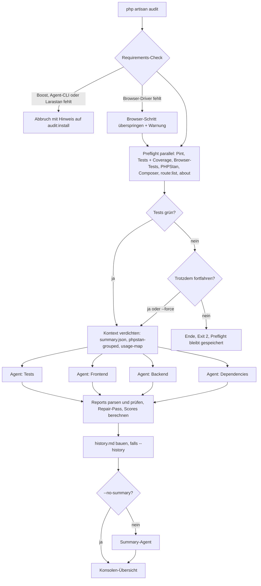

# astro2006/laravel-audit – Konzept

> Status: Entwurf v0.1 · 11.09.2026

## 1. Idee in einem Satz

Ein Dev-Package, das als **Harness** für KI-Agenten (über Laravel Boost) funktioniert: Alles, was sich deterministisch messen lässt (Lint, Tests, Coverage, PHPStan, Composer Audit), läuft **vor** den Agents lokal. Die Agents bekommen nur verdichtete Ergebnisse plus Codebase-Kontext und liefern ausschließlich das, was nur eine KI kann: Urteil, Klassifizierung, Bewertung und konkrete Empfehlungen.

## 2. Leitprinzipien

| Prinzip | Bedeutung |
|---|---|
| Messen vor Denken | Tools laufen einmal, vor den Agents. Kein Agent führt Tests, PHPStan oder `composer audit` selbst aus. |
| Pfade statt Inhalte | Agents bekommen eine kompakte `summary.json` plus Dateipfade zu Rohdaten. Sie lesen nur, was sie brauchen. |
| Klare Zuständigkeiten | Jeder Agent hat einen festen Scope. Überschneidungen sind explizit geregelt, damit keine Doppel-Findings (und doppelte Tokens) entstehen. |
| Ein Report, strikt strukturiert | Jeder Agent liefert genau **einen** Report `{audit}.md` in einem festen Markdown-Format (`resources/schemas/report-format.md`). Das Package parst sie für Validierung, Scores, Trends und CI. |
| Read-only | Agents schreiben gar keine Dateien. Sie geben ihren Report als Antwort zurück, das Package speichert ihn (siehe 8.3). |
| Deterministische Scores | Scores berechnet das Package aus den geparsten Findings, nicht die KI. Damit sind Runs vergleichbar. |

## 3. Anmerkungen zu deinem Entwurf

Ein paar Punkte, die ich angepasst habe, weil sie so technisch nicht funktionieren oder sich besser lösen lassen:

**Package-Name:** Composer erlaubt nur Kleinbuchstaben im Vendor-Namen, also `astro2006/laravel-audit`.

**`composer require ... --dev --dusk` geht nicht.** Composer kennt keine package-spezifischen Flags, und Scripts von Dependencies laufen beim Require nicht. Lösung: ein Install-Command.

```bash
composer require astro2006/laravel-audit --dev
php artisan audit:install            # zeigt fehlende Pakete, fragt, installiert. Driver: Playwright
php artisan audit:install --dusk     # dasselbe mit Browser-Driver Dusk

php artisan audit --dusk             # Override nur für diesen Run
php artisan audit --playwright       # Override in die andere Richtung
```

Details in Kapitel 6.

**Larastan hat kein eigenes Binary.** Larastan ist eine PHPStan-Extension. Der Aufruf ist `vendor/bin/phpstan analyse`, nicht `vendor/bin/larastan analyse`.

**"Alles parallel" vs. deine nummerierten Schritte.** Das habe ich so aufgelöst: Preflight-Tools laufen parallel (sie sind unabhängig voneinander und kosten keine Tokens), dann kommt das Test-Gate, dann starten die Agents parallel, zuletzt die Summary. Du verlierst beim Abbruch am Gate nur ein paar Sekunden CPU-Zeit, gewinnst aber Wall-Clock-Zeit, weil PHPStan und Composer Audit nicht auf die Tests warten müssen.

**Playwright als Default** heißt im Laravel-Ökosystem praktisch: Pest 4 Browser-Plugin (`pestphp/pest-plugin-browser`, nutzt Playwright unter der Haube). Falls ein Projekt eine eigene `playwright.config.*` hat, kann alternativ `npx playwright test` laufen. Dusk braucht zusätzlich ChromeDriver und einen laufenden App-Server.

**Testergebnisse speichern: ja, dauerhaft pro Run.** Gründe: Die Agents brauchen die Ergebnisse ohnehin als Dateien, du kannst Befunde später nachvollziehen, und Trends zwischen Runs (neu/behoben) werden möglich. Die Dateien sind klein. Aufräumen per `php artisan audit:prune --keep=5`. Mit `--history=N` fließen die letzten N Runs in die Summary ein (siehe 9.4).

## 4. Ablauf



Beispiel-Ausgabe:

```
$ php artisan audit

 laravel-audit · Run 2026-09-11_14-30-05 · Agent: claude · Browser: Playwright

 Requirements
  ✔ Boost installiert
  ✔ Larastan (phpstan.neon gefunden, Level 5)
  ✔ Coverage-Treiber: pcov

 Preflight
  ✔ Pint ............................ 7 Dateien mit Style-Issues
  ✘ Tests ........................... 3/412 fehlgeschlagen
  ✔ Browser (Playwright) ............ 18/18
  ✔ PHPStan (Level 5) ............... 214 Fehler (12 Identifier)
  ✔ Composer Audit .................. 2 Advisories, 1 abandoned

  3 Tests schlagen fehl. Trotzdem mit den Audits fortfahren? (yes/no) [no]

 Agents
  ✔ tests ......... 14 Findings  (3m12s)
  ✔ frontend ...... 11 Findings  (4m03s)
  ✔ backend ....... 19 Findings  (5m40s)
  ✔ dependencies ..  6 Findings  (1m21s)
  ✔ summary ....... SUMMARY.md

 Score: 68/100 (C) · Critical 1 · High 6 · Medium 17 · Low 20 · Info 6
 → Audit/2026-09-11_14-30-05/SUMMARY.md
```

## 5. Commands & Optionen

| Command | Wirkung |
|---|---|
| `php artisan audit` | Alle Audits + Summary |
| `php artisan audit --tests` / `--frontend` / `--backend` / `--dependencies` | Nur die genannten Audits (kombinierbar, z. B. `--backend --frontend`) |
| `--no-summary` | Summary-Agent überspringen |
| `--history=5` | Die letzten 5 abgeschlossenen Runs (nach Zeitstempel) als Historie in die Summary geben (siehe 9.4) |
| `--force` | Test-Gate überspringen (fortfahren trotz Fehlern) |
| `--playwright` / `--dusk` | Browser-Driver nur für diesen Run überschreiben (schließen sich gegenseitig aus) |
| `--no-browser` | Browser-Tests für diesen Run überspringen |
| `--skip-preflight` | Letzten Preflight wiederverwenden (spart Zeit beim Prompt-Tuning) |
| `--preflight-only` | Nur Tools laufen lassen, keine Agents (0 Tokens) |
| `php artisan audit:install [--dusk\|--playwright] [--dry-run] [--yes]` | Setup: fehlende Pakete sammeln, um Erlaubnis fragen, installieren, Config, `.gitignore` (siehe 6.1) |
| `php artisan audit:prune --keep=5` | Alte Runs löschen (warnt, wenn `--keep` kleiner als `summary.history` ist) |

Exit-Codes (wichtig für CI später): `0` fertig, `1` Findings über Schwelle (später `--fail-on=high`), `2` am Gate abgebrochen, `3` Harness-Fehler.

`--skip-preflight` und `--preflight-only` sind beim Weiterentwickeln der Prompts Gold wert: Preflight einmal laufen lassen, dann nur noch Agents iterieren.

## 6. Installation & Voraussetzungen

Grundregel: **Alles, was gebraucht wird, kommt bei `audit:install`, und zwar nur mit deiner Zustimmung.** Der Command sammelt zuerst alle fehlenden Pakete, zeigt sie mit Begründung und den exakten Befehlen an und fragt dann: „Ich brauche diese Pakete. Darf ich sie installieren?“ Ohne Ja wird nichts an `composer.json` oder `package.json` geändert.

`php artisan audit` installiert nie etwas. Es prüft nur und verweist bei fehlenden Teilen auf `audit:install`. So gibt es keine Überraschungen mitten im Run und keine Änderungen an Abhängigkeiten in CI.

### 6.1 `php artisan audit:install`

```bash
php artisan audit:install               # Browser-Driver: Playwright (Default)
php artisan audit:install --dusk        # Browser-Driver: Dusk
php artisan audit:install --playwright  # explizit Playwright, z. B. um von Dusk zurückzuwechseln
php artisan audit:install --dry-run     # nur anzeigen, was fehlt und was ausgeführt würde
php artisan audit:install --yes         # alles ohne Rückfrage installieren (Skripte, Provisioning)
```

**Was geprüft wird**

| Paket | Wofür | Nötig wenn |
|---|---|---|
| `laravel/boost` (composer, dev) | Kontext, Guidelines und Skills für die Agents | immer |
| `larastan/larastan` (composer, dev) | Statische Analyse mit PHPStan | Audits `tests` oder `backend` aktiv |
| `laravel/pint` (composer, dev) | Lint-Schritt | Audit `backend` aktiv |
| `pestphp/pest-plugin-browser` (composer, dev) | Browser-Tests mit Playwright | Driver `playwright` |
| `pestphp/pest` (composer, dev) | Voraussetzung für das Browser-Plugin | Driver `playwright` und das Projekt nutzt nur PHPUnit |
| `playwright` (npm, dev) + Browser-Binaries | Browser-Engine | Driver `playwright` |
| `laravel/dusk` (composer, dev) | Browser-Tests mit Dusk | Driver `dusk` |

Welche Audits aktiv sind, kommt aus `config('audit.audits')`. Wer z. B. nie `backend` laufen lässt, wird nicht nach Pint gefragt.

Zwei Sonderfälle bekommen einen eigenen Hinweis in der Liste:

- **Nur PHPUnit + Playwright:** Das Browser-Plugin braucht Pest. Pest führt bestehende PHPUnit-Tests unverändert mit aus, trotzdem ist das eine spürbare Änderung am Projekt. Der Hinweis nennt die Alternative `--dusk`.
- **Pest-Version zu alt für das Browser-Plugin:** Das wäre ein Major-Upgrade. Es wird als „Upgrade“ markiert und nie in „Ja, alle“ eingeschlossen, sondern einzeln abgefragt.

**Was nicht installiert werden kann** (nur Hinweise mit Anleitung, am Ende der Ausgabe): Coverage-Treiber (pcov oder xdebug), Agent-CLI (z. B. Claude Code), Node/npm für Playwright.

**Ablauf**

1. Config `config/audit.php` publishen, `AUDIT_BROWSER_DRIVER` in `.env` und `.env.example` schreiben.
2. Alle Voraussetzungen prüfen und daraus einen Installationsplan bauen.
3. Plan anzeigen: fehlende Pakete mit Zweck, danach die exakten Befehle.
4. Zustimmung einholen: **Ja, alle** · **Auswählen** (Liste, alles vorausgewählt, einzelne abwählbar) · **Nein**.
5. Ausführen, gebündelt statt Paket für Paket:
   - ein einziges `composer require --dev …` für alle Composer-Pakete (eine Dependency-Auflösung statt mehrerer)
   - ein `npm install --save-dev …` (pnpm, yarn oder bun, falls deren Lockfile existiert)
   - danach die Setup-Schritte: `phpstan.neon` aus dem Stub (nur wenn keine existiert), `php artisan boost:install` (interaktiv, Agent-Auswahl), `npx playwright install` bzw. `php artisan dusk:install`
6. Erneut prüfen, ob jetzt alles da ist.
7. **Agent festlegen:** Stehen in `boost.json` mehrere Agents mit installierter CLI, einmal fragen, welcher die Audits ausführen soll, und als `AUDIT_AGENT` in die `.env` schreiben.
8. `/Audit` in `.gitignore` eintragen.
9. Abschlussübersicht: installiert, abgelehnt (mit Konsequenz, z. B. „Ohne Larastan laufen `tests` und `backend` nicht“), manuell zu erledigen.

Beispiel:

```
$ php artisan audit:install

 laravel-audit · Setup · Browser-Driver: Playwright

 Bereits vorhanden
  ✔ laravel/pint
  ✔ pestphp/pest

 Ich brauche diese Pakete:

  larastan/larastan ............. Statische Analyse (tests, backend)    composer --dev
  laravel/boost ................. Kontext und Skills für die Agents     composer --dev
  pestphp/pest-plugin-browser ... Browser-Tests mit Playwright          composer --dev
  playwright .................... Browser-Engine (~ mehrere 100 MB)    npm --save-dev

 Dafür würde ich ausführen:
  composer require --dev larastan/larastan laravel/boost pestphp/pest-plugin-browser
  npm install --save-dev playwright@latest
  npx playwright install
  php artisan boost:install    (interaktiv)

 Darf ich diese Pakete installieren?
  › Ja, alle
    Auswählen
    Nein

 …

 Fertig.
  ✔ 4 Pakete installiert, phpstan.neon erstellt (Level 9), /Audit in .gitignore
  ⚠ Kein Coverage-Treiber aktiv → z. B. `pecl install pcov`
  ⚠ Agent-CLI `claude` nicht im PATH → siehe Claude-Code-Doku
```

**Nicht-interaktiv:** Mit `--no-interaction` ohne `--yes` wird nichts installiert. Der Plan wird ausgegeben, und der Command endet mit Exit 1, falls etwas Nötiges fehlt. Mit `--yes` wird alles aus dem Plan installiert, außer als „Upgrade“ markierten Paketen; die brauchen immer eine explizite Zustimmung.

Der Command ist idempotent und kann jederzeit erneut laufen, z. B. nach dem Aktivieren weiterer Audits oder um den Driver dauerhaft zu wechseln. Bestehende Configs (`phpstan.neon`, `boost.json`) werden nie überschrieben. Eine vorhandene `phpstan.neon` wird so genutzt, wie sie ist, inklusive Level (siehe 7.7). `audit:install` zeigt nur an, welches Level gefunden wurde.

### 6.2 Browser-Driver zur Laufzeit

Priorität: **CLI-Flag > `.env` / Config > Default (`playwright`)**.

```bash
php artisan audit               # Driver aus .env / Config
php artisan audit --dusk        # nur dieser Run mit Dusk
php artisan audit --playwright  # nur dieser Run mit Playwright
php artisan audit --no-browser  # nur dieser Run ohne Browser-Tests
```

- Der Override gilt nur für den aktuellen Run und wird nicht gespeichert. Dauerhaft wechseln: `audit:install --dusk` bzw. `--playwright`.
- `--dusk`, `--playwright` und `--no-browser` schließen sich gegenseitig aus. Mehrere gleichzeitig → Fehler, Exit 3.
- Der effektive Driver steht im Konsolen-Header, in `preflight/summary.json` und im Platzhalter `{{browser_driver}}` für die Agents.
- Ist der gewählte Driver nicht installiert, wird nur der Browser-Schritt übersprungen. Die Warnung nennt beide Wege: `php artisan audit:install --dusk` (installiert und setzt Dusk als Default) oder die exakten Befehle, um Dusk nur zusätzlich zu installieren. Der Rest des Audits läuft weiter; ein einmaliger Override soll nicht den ganzen Run abbrechen.

### 6.3 Checks bei `php artisan audit`

| Tool | Check | Wenn fehlt |
|---|---|---|
| Composer | `composer --version` | Abbruch |
| Laravel Boost | `laravel/boost` in `composer.lock` + `boost.json` | Abbruch mit Hinweis `php artisan audit:install` |
| Agent-CLI | Binary des gewählten Drivers im PATH | Abbruch mit Install-Hinweis |
| Larastan | `larastan/larastan` in `composer.lock` | Abbruch mit Hinweis `php artisan audit:install`, aber nur wenn ein gewählter Audit PHPStan braucht (`tests`, `backend`). `--frontend` und `--dependencies` laufen ohne. |
| Pint | `vendor/bin/pint` | Lint-Schritt überspringen + Warnung mit Hinweis `php artisan audit:install` |
| Coverage-Treiber | `php -m` enthält pcov oder xdebug | Tests ohne Coverage + Warnung, Tests-Agent weiß: Coverage unbekannt |
| Playwright | `pestphp/pest-plugin-browser` bzw. `node_modules/playwright` | Browser-Schritt überspringen + Warnung mit Hinweis `php artisan audit:install` |
| Dusk | `laravel/dusk` + ChromeDriver | Browser-Schritt überspringen + Warnung mit Hinweis `php artisan audit:install --dusk` |

Stub `phpstan.neon` (nur wenn weder `phpstan.neon` noch `phpstan.neon.dist` existiert):

```neon
includes:
    - vendor/larastan/larastan/extension.neon

parameters:
    level: 9
    paths:
        - app
        - tests
```

## 7. Preflight

### 7.1 Schritte

| Schritt | Befehl | Output unter `preflight/` |
|---|---|---|
| App-Info | `php artisan about --json` | `about.json` |
| Stack-Erkennung | composer.json / package.json lesen (Livewire, Inertia, Vue/React, Filament, Alpine, Tailwind, Pest/PHPUnit) | in `summary.json` |
| Lint | `vendor/bin/pint --test --format=json` (+ optional `npm run lint`) | `pint.json` |
| Tests | `php artisan test --parallel --log-junit=… --coverage-clover=…` | `tests/junit.xml`, `tests/coverage.xml` |
| Browser | Playwright: Pest-Browser-Suite · Dusk: `php artisan dusk --log-junit=…` | `tests/browser-junit.xml` |
| PHPStan | `vendor/bin/phpstan analyse --error-format=json --no-progress --memory-limit=2G` mit der Projekt-Config, ohne `--level` (siehe 7.7), danach Baseline-Datei auslesen (siehe 7.6) | `phpstan/phpstan.json`, `phpstan/phpstan-grouped.json` |
| Routen | `php artisan route:list --json` | `routes.json` |
| Composer | `composer audit --format=json --locked` · `composer show --direct --format=json` · `composer outdated --direct --format=json` · `composer licenses --format=json` · `composer validate --no-check-publish` · `composer why <pkg>` für jedes betroffene Paket | `composer/*.json` |
| Usage-Map | Package-Skript (siehe 7.5) | `composer/usage-map.json` |
| npm (optional) | `npm audit --json` | `npm-audit.json` |

### 7.2 Welcher Audit braucht was

Bei Einzelaufrufen läuft nur, was gebraucht wird. `php artisan audit --dependencies` startet also keine Tests.

| Schritt | tests | frontend | backend | dependencies |
|---|:-:|:-:|:-:|:-:|
| about + Stack | ✓ | ✓ | ✓ | ✓ |
| Pint | | | ✓ | |
| Tests + Coverage | ✓ | | | |
| Browser-Tests | ✓ | (✓) | | |
| PHPStan | ✓ | | ✓ | |
| route:list | ✓ | ✓ | ✓ | |
| Composer + Usage-Map | | | | ✓ |

Tests laufen nur, wenn ein gewählter Audit sie braucht. Das Test-Gate greift entsprechend nur, wenn der Test-Schritt gelaufen ist.

### 7.3 Exit-Codes sind Daten

`composer audit`, `phpstan`, `pint --test` und fehlschlagende Tests liefern alle Exit-Code ≠ 0. Das ist **kein** Harness-Fehler, sondern das Ergebnis. Ein Schritt gilt nur als gescheitert, wenn kein verwertbarer Output entstanden ist (z. B. PHPStan Out-of-Memory, kaputtes JSON). Dann: Warnung, Schritt in `summary.json` als `"status": "error"` markieren, Agents wissen Bescheid.

### 7.4 Test-Gate

1. Alles grün → weiter.
2. Fehler → Übersicht: `x/y fehlgeschlagen`, die ersten 5 Testnamen, gemeinsame Exception.
3. Heuristik „Umgebung kaputt“: > 90 % rot mit derselben Exception (z. B. DB-Verbindung, fehlender APP_KEY) → deutliche Warnung, dass ein Audit hier keinen Sinn ergibt.
4. Frage „Trotzdem fortfahren?“, Default **Nein**.
5. `--force` überspringt die Frage. `--no-interaction` ohne `--force` bricht ab (Exit 2), damit CI keine Tokens verbrennt.
6. Bei Abbruch bleibt `Audit/{ts}/preflight/` erhalten.

Konfigurierbar als `preflight.tests.gate`: `ask` | `abort` | `continue`.

### 7.5 Verdichtung (Token-Hebel Nr. 1)

Rohdaten können riesig sein (PHPStan-JSON mit tausenden Einträgen). Das Package erzeugt deshalb kompakte Zusammenfassungen, die Agents zuerst lesen:

`preflight/summary.json`:

```json
{
  "run_id": "2026-09-11_14-30-05",
  "app": { "name": "Shop", "laravel": "12.x", "php": "8.4", "env": "local" },
  "stack": { "frontend": ["livewire", "alpine", "tailwind"], "test_framework": "pest", "browser_driver": "playwright" },
  "lint": { "status": "ok", "files_with_issues": 7, "file": "preflight/pint.json" },
  "tests": { "status": "ok", "total": 412, "passed": 405, "failed": 3, "skipped": 4, "duration_s": 38.2,
             "failing": ["Tests\\Feature\\CheckoutTest::it applies coupon"], "file": "preflight/tests/junit.xml" },
  "coverage": { "available": true, "lines_pct": 71.4, "file": "preflight/tests/coverage.xml" },
  "browser": { "status": "ok", "driver": "playwright", "total": 18, "failed": 0 },
  "phpstan": { "status": "ok", "level": 5, "level_source": "phpstan.neon", "errors": 214, "baseline_entries": 0,
               "top_identifiers": { "missingType.iterableValue": 88, "argument.type": 31 },
               "file": "preflight/phpstan/phpstan-grouped.json" },
  "composer": { "advisories": 2, "abandoned": 1, "outdated_major": 3 },
  "routes": { "count": 96, "file": "preflight/routes.json" }
}
```

`phpstan-grouped.json` gruppiert Fehler nach Identifier und Datei (Anzahl + 3 Beispiele pro Gruppe). `usage-map.json` enthält pro direkter Dependency: PSR-4-Namespaces (aus `vendor/composer/installed.json`), Anzahl Referenzen getrennt nach Prod-Code und `tests/`, Top-5-Dateien, ob Provider/Aliases per Auto-Discovery registriert werden, und ob Binaries in Scripts/CI vorkommen. Damit muss der Dependency-Agent nicht selbst durch die Codebase greppen.

### 7.6 PHPStan-Baseline

Eine Baseline ist eine Datei (meist `phpstan-baseline.neon`), in der ein Projekt alle aktuell bekannten PHPStan-Fehler einmal festhält. PHPStan ignoriert diese Fehler danach und meldet nur noch neue. Das ist üblich, wenn man PHPStan in ein bestehendes Projekt einführt: Man fängt nicht mit 500 Fehlern an, sondern sorgt nur dafür, dass keine neuen dazukommen.

Für ein Audit ist das ein Problem: Hat ein Projekt 300 Fehler in der Baseline, meldet PHPStan „0 Fehler“, und das Projekt sieht sauberer aus, als es ist.

Lösung ohne zweiten PHPStan-Lauf: Die Baseline-Datei enthält die ignorierten Fehler selbst (Meldung, Datei, Anzahl, Identifier). Das Package

1. lässt PHPStan **einmal** normal mit der Projekt-Config laufen (Baseline aktiv, also nur neue Fehler),
2. liest zusätzlich die Baseline-Datei aus (NEON- oder PHP-Format),
3. schreibt beides in `phpstan-grouped.json`: aktive Fehler normal, Baseline-Einträge als `baselined` markiert.

Der Tests-Agent sieht so das komplette Bild. Er meldet Baseline-Einträge als eine gebündelte „bekannte Altlast“ (Anzahl, häufigste Fehlerarten, Top-Dateien), nicht als neue Bugs. Nur ein Baseline-Eintrag, der ein echter Bug in sicherheitskritischem Code ist, bekommt ein eigenes Finding. Hat ein Projekt keine Baseline, ändert sich nichts.

### 7.7 PHPStan-Level

**Das Package ändert das Level nicht.** Hat das Projekt schon eine `phpstan.neon` (oder `phpstan.neon.dist`), läuft PHPStan genau mit dieser Config: Level 5 bleibt Level 5, Level 10 bleibt Level 10. Es wird kein `--level` übergeben. Nur wenn es gar keine Config gibt, legt `audit:install` den Stub mit Level 9 an.

**Das Level wird bei jedem Run frisch ausgelesen, nicht in `config/audit.php` gespeichert.** Einmal bei der Installation auslesen und in die Config schreiben würde zwei Stellen für dieselbe Information schaffen: Erhöhst du später in `phpstan.neon` auf Level 8, stünde in der Audit-Config noch die 5, und der Audit würde mit dem alten Wert laufen. Deshalb bleibt `phpstan.neon` die einzige Quelle.

Auslesen: bevorzugt über PHPStan selbst (`vendor/bin/phpstan dump-parameters --json`, falls die installierte Version das kann), weil PHPStan dabei `includes` und `level: max` korrekt auflöst. Sonst ein einfacher Parser über die Config und ihre `includes`. Wird kein Level gefunden, steht `unknown` in der Übersicht.

Wo das Level sichtbar ist:

- `audit:install`: „phpstan.neon gefunden, Level 5, wird so genutzt“
- Konsole beim Audit: `PHPStan (Level 5)`
- `preflight/summary.json`: `level` und `level_source`
- Prompts: Platzhalter `{{phpstan_level}}`, damit der Tests-Agent weiß, auf welchem Level die Ergebnisse entstanden sind

Wer für Audits bewusst ein anderes Level will als im Alltag, setzt `preflight.phpstan.level` in `config/audit.php`. Standard ist `null` (= wie in `phpstan.neon`); nur ein explizit gesetzter Wert wird als `--level` übergeben.

Das Level selbst ist die Entscheidung des Projekts und kein Finding. Der Tests-Agent darf höchstens ein `info`-Finding schreiben, wie viel Aufwand der nächste Level-Schritt wäre.


## 8. Agent-Harness

### 8.1 Agent und die Rolle von Boost

**Boost wählt keinen Agent aus und startet auch keinen.** Boost richtet für die bei `boost:install` gewählten Agents die MCP-Verbindung und die Guideline-Dateien ein (`.mcp.json`, `AGENTS.md`, `CLAUDE.md` …) und merkt sich die Auswahl in `boost.json`. Unser Package nutzt `boost.json` nur, um den Agent zu erkennen. Gestartet wird er vom Package.

**Ein Agent für alle Audits.** Im MVP laufen alle Audits und die Summary mit demselben Agent, und zwar so, wie er im Terminal schon eingerichtet ist: mit dem Modell und den Einstellungen aus seiner eigenen Config. Das Package gibt kein Modell vor.

Welcher Agent:

1. `AUDIT_AGENT` in der `.env`, falls gesetzt.
2. Sonst automatisch: die Agents aus `boost.json`, deren CLI installiert ist. Ist es genau einer, wird er genommen. Sind es mehrere, fragt `audit:install` einmal und schreibt die Wahl als `AUDIT_AGENT` in die `.env`.

Mehrere Agents, verschiedene Modelle pro Audit und selbst gehostete Modelle sind als späteres Feature vorgesehen (siehe Roadmap).

**Driver-Interface**

```php
interface AgentDriver
{
    public function name(): string;                        // 'claude'
    public function isAvailable(): bool;                   // Binary im PATH?
    /** @return list<string> argv */
    public function command(AuditRun $run, Audit $audit): array;
    public function extractAnswer(string $stdout): string; // finale Antwort aus der CLI-Ausgabe holen
}
```

Headless-Aufrufe (Flags gegen die jeweils aktuelle CLI-Doku prüfen): Claude Code `claude -p`, Codex `codex exec`, Gemini CLI `gemini -p`. Der Prompt wird immer per **STDIN** übergeben, nicht als Argument (Längenlimits, Escaping).

### 8.2 Parallelisierung

`Illuminate\Support\Facades\Process::pool()` startet alle Agents gleichzeitig (`agent.concurrency`, Default 4). Live-Status mit Laravel Prompts. Pro Agent: Timeout (Default 30 min), stdout/stderr in `logs/{audit}.log`. Scheitert ein Agent oder läuft in den Timeout, wird das im Report vermerkt, die anderen laufen weiter, die Summary arbeitet mit dem, was da ist.

### 8.3 Rechte & Rückgabe des Reports

**Der Agent schreibt keine Datei, er antwortet.** Jedes Kommandozeilen-Programm hat eine Standard-Ausgabe (fachlich „stdout“): der Text, der normalerweise im Terminal erscheint. Wenn der Harness einen Agent headless startet, ist die finale Antwort des Agents genau dieser Text. Das Package fängt ihn ab und speichert ihn selbst als `Audit/{ts}/{audit}.md`. Für dich als Nutzer ändert sich nichts, die Datei liegt am Ende an derselben Stelle.

Vergleich: Variante „Agent schreibt selbst“ ist wie einem Handwerker den Büroschlüssel zu geben, damit er seinen Bericht auf deinen Tisch legt. Variante „Antwort“ ist, dass er den Bericht an der Tür abgibt und du ihn selbst hinlegst. Er braucht keinen Schlüssel.

Warum das der Default ist:

- **Sicherer:** Der Agent braucht überhaupt keine Schreibrechte. Er kann nichts im Projekt verändern, auch nicht versehentlich.
- **Einfacher zu bauen:** Schreibrechte auf genau einen Ordner zu beschränken ist je nach Agent-CLI fummelig. „Gar keine Schreibrechte“ ist eine einzige Einstellung.
- **Validierung vor dem Speichern:** Das Package prüft den Report, bevor er als Datei existiert.
- **Repair-Pass trivial:** fehlerhafte Antwort + Fehlerliste zurückgeben, neue Antwort speichern.

Umsetzung: Der Driver holt die finale Antwort aus der CLI-Ausgabe (bei manchen CLIs als Feld in einer JSON-Ausgabe) und bereinigt sie. Alles vor der ersten `---`-Zeile wird entfernt (falls der Agent doch „Hier ist der Report:“ schreibt), ebenso ein umschließender Code-Block. Die komplette Rohausgabe landet zusätzlich in `logs/{audit}.log`.

Rechte, wo die CLI es erlaubt: Lesen und Suchen im Projekt erlaubt, keinerlei Schreibrechte, Shell nur für eine Whitelist (kein `artisan test`, kein `composer update`), Boost-MCP-Tools erlaubt. Die Prompts wiederholen diese Regeln zusätzlich.

Fallback für Agent-CLIs, die keine saubere Antwort ausgeben können: `agent.output_mode = 'file'`. Dann hängt der Harness an den Prompt eine Zeile an, die den Agent anweist, den Report selbst nach `Audit/{ts}/{audit}.md` zu schreiben, und erlaubt Schreibrechte nur für diesen Ordner.

### 8.4 Validierung & Repair-Pass

Nach jedem Agent parst der `ReportParser` die zurückgegebene Antwort und der `ReportLinter` prüft sie gegen `resources/schemas/report-format.md` (Frontmatter, Pflicht-Sections, ID-Muster, Pflichtfelder, erlaubte Werte). Bei Fehlern **ein** Repair-Pass: gleicher Agent, Mini-Prompt „Hier ist dein Report und die Liste der Formatfehler, gib den korrigierten Report aus“. Kostet wenig, erspart kaputte Runs.

Bonus, den JSON so nicht hatte: Der Linter prüft, ob jede referenzierte Datei wirklich existiert und die Zeilennummer im Rahmen liegt. Das fängt halluzinierte Pfade ab, bevor sie im Report landen (Warnung, kein Abbruch).

Der Parser braucht keine Dependency: Frontmatter sind simple `key: value`-Zeilen, Findings erkennt er an `### ID — Titel` plus zweispaltiger Tabelle, und er ist fence-aware (Strukturzeichen in Code-Blöcken werden ignoriert).

### 8.5 Prompt-Rendering

Finaler Prompt = `_base.md` + `{audit}.md` + Custom Checks aus der Config. Platzhalter werden per `strtr()` ersetzt, **nicht mit Blade**, weil die Prompts Blade-Syntax wie `{!! !!}` und `@csrf` als Prüfgegenstand enthalten.

| Platzhalter | Beispiel |
|---|---|
| `{{project_name}}` | Shop |
| `{{laravel_version}}` / `{{php_version}}` | 12.x / 8.4 |
| `{{test_framework}}` / `{{browser_driver}}` | pest / playwright (effektiver Driver inkl. Laufzeit-Override) |
| `{{phpstan_level}}` | 5 (aus `phpstan.neon` gelesen) oder `unknown` |
| `{{frontend_stack}}` | livewire, alpine, tailwind |
| `{{run_id}}` | 2026-09-11_14-30-05 |
| `{{output_dir}}` / `{{preflight_dir}}` | Audit/2026-09-11_14-30-05 / …/preflight |
| `{{audit_key}}` / `{{id_prefix}}` / `{{audit_title}}` | backend / BE / Backend Audit |
| `{{report_language}}` | de |
| `{{exclude_paths}}` | vendor, node_modules, … |
| `{{custom_checks}}` | Liste aus Config oder „None.“ |
| `{{history_file}}` / `{{history_runs}}` | Pfad zu `history.md` oder leer / Anzahl verglichener Runs (nur Summary) |

## 9. Output

```
Audit/
└── 2026-09-11_14-30-05/
    ├── preflight/
    │   ├── summary.json
    │   ├── about.json
    │   ├── pint.json
    │   ├── routes.json
    │   ├── tests/        junit.xml, coverage.xml, browser-junit.xml
    │   ├── phpstan/      phpstan.json, phpstan-grouped.json
    │   └── composer/     audit.json, show.json, outdated.json, licenses.json, why.json, usage-map.json, validate.txt
    ├── tests.md
    ├── frontend.md
    ├── backend.md
    ├── dependencies.md
    ├── run.md             (Manifest: Status, Zeit, Audits, Git-Commit, vom Package)
    ├── scores.md          (vom Package aus den geparsten Findings berechnet)
    ├── history.md         (nur mit --history, vom Package)
    ├── SUMMARY.md
    └── logs/
```

Zeitstempel ohne Doppelpunkte (`Y-m-d_H-i-s`), sonst Probleme unter Windows. `audit:install` ergänzt `/Audit` in der `.gitignore`: Die Reports enthalten konkrete Schwachstellen und gehören nicht ins Repo.

### 9.1 Finding

Vollständige Spezifikation: `resources/schemas/report-format.md`. Ein Finding im Report sieht so aus:

````markdown
### BE-003 — Unfiltered request data passed to OrderService::update()

| Field | Value |
|---|---|
| Severity | high |
| Confidence | confirmed |
| Category | security |
| Effort | S |
| Locations | `app/Services/OrderService.php:42-48`, `app/Http/Controllers/OrderController.php:57` |
| Occurrences | 2 |
| References | CWE-915, OWASP A08:2021 |
| Related | FE-006 |

**Evidence**
```php
$order->fill($data)->save();
```

**Impact**
Kunden können `status`, `total` oder `user_id` ihrer eigenen Bestellungen setzen.

**Recommendation**
`$request->validated()` aus einem Form Request übergeben, `$fillable` statt `$guarded = []`.

---
````

Maschinell gelesen werden nur Frontmatter, Finding-Überschriften und die Metadaten-Tabellen. Alles andere (Evidence, Impact, audit-spezifische Sections wie Coverage-Map oder Dependency-Inventar) ist freies Markdown und muss nicht geparst werden. Warum Markdown statt JSON + Markdown: Die Agents schreiben den Inhalt nur einmal statt doppelt, das spart grob die Hälfte der Output-Tokens. Die Tabelle ist dabei fast so strikt wie JSON, aber für Menschen direkt lesbar.

### 9.2 Severity

| Severity | Bedeutung |
|---|---|
| critical | Remote ausnutzbar ohne/mit geringen Rechten, Datenverlust, vollständige Kompromittierung, CVE in erreichbarem Code. Sofort fixen. |
| high | Sicherheitslücke mit Vorbedingung, kaputte Kernfunktion, Leak personenbezogener Daten. Vor dem nächsten Release. |
| medium | Bug abseits des Kernpfads, fehlende Defense-in-Depth, relevante Testlücke bei kritischer Logik, Performance-Problem unter realer Last. |
| low | Kleiner Bug, Code-Smell mit echten Wartungskosten, Inkonsistenz. |
| info | Beobachtung, Vorschlag, kein direktes Risiko. |

Dazu **Confidence**: `confirmed` (im Code nachvollzogen), `likely` (eine Annahme statisch nicht prüfbar), `suspected` (Pattern-Match, menschliche Prüfung nötig). Unsicherheit wird über Confidence ausgedrückt, nicht durch aufgeblasene Severity.

### 9.3 Score (deterministisch)

```
score = max(0, 100 − Σ weight[severity] × factor[confidence])
weight:  critical 20 · high 10 · medium 4 · low 1 · info 0
factor:  confirmed 1.0 · likely 0.7 · suspected 0.3
Grade:   A ≥ 90 · B ≥ 75 · C ≥ 60 · D ≥ 40 · F < 40
```

Pro Audit und gesamt, geschrieben als Tabelle in `scores.md`. Gewichte in der Config anpassbar.

### 9.4 Run-Historie & `--history`

Die Zeitstempel-Ordner sind die Grundlage für die Historie. Mit `--history=N` bekommt die Summary die letzten N abgeschlossenen Runs als Kontext.

```bash
php artisan audit --history=5     # oder: --history 5
php artisan audit --backend --history=3
```

**Welche Runs zählen**

Jeder Run bekommt eine kleine Manifest-Datei `run.md`, die der Harness am Start anlegt und am Ende aktualisiert:

```markdown
---
format: 1
run_id: 2026-09-11_14-30-05
started_at: 2026-09-11T14:30:05+02:00
finished_at: 2026-09-11T14:41:52+02:00
status: completed        # running | aborted | failed | completed
audits: tests, frontend, backend, dependencies
browser_driver: playwright
agent: claude
model: claude-opus-5     # aus der CLI-Ausgabe gelesen, sonst cli-default
git_branch: main
git_commit: a1b2c3d
git_dirty: true
---
```

- Sortiert wird nach `started_at` aus `run.md`, nicht nach dem Ordnernamen. Der Ordnername (`Y-m-d_H-i-s`) sortiert zwar auch chronologisch, aber nicht zuverlässig bei Zeitzonen-Wechseln oder der doppelten Stunde bei der Zeitumstellung.
- Es zählen nur Runs mit `status: completed`. Am Gate abgebrochene Runs, `--preflight-only`-Runs und gescheiterte Runs werden übersprungen, damit „5 Runs“ auch wirklich 5 auswertbare Runs sind.
- Gibt es weniger als N passende Runs (z. B. nach `audit:prune`), nimmt der Harness alle vorhandenen und schreibt eine Warnung: „Nur 3 frühere Runs vorhanden.“
- Runs mit anderen Audits sind erlaubt. Verglichen wird pro Audit nur dort, wo das Audit im alten Run auch gelaufen ist.
- Optional `summary.same_branch_only`: nur Runs vom selben Git-Branch.

**Der Harness verdichtet, nicht die KI**

Fünf alte Runs komplett in den Kontext zu laden wäre teuer. Deshalb parst der Harness die alten Reports mit demselben `ReportParser` und schreibt deterministisch eine einzige Datei `history.md`. Nur diese liest der Summary-Agent.

```markdown
---
format: 1
current_run: 2026-09-11_14-30-05
history: 5
runs_found: 5
---

# Audit History

## Runs
| Run | Branch | Commit | Agent / Model | Audits | Score | Grade | Critical | High | Medium | Low |
|---|---|---|---|---|---|---|---|---|---|---|
| 2026-09-11_14-30-05 (current) | main | a1b2c3d | claude / claude-opus-5 | all | 68 | C | 1 | 6 | 17 | 20 |
| 2026-09-04_09-12-44 | main | 9f8e7d6 | claude / claude-opus-5 | all | 61 | C | 2 | 7 | 19 | 22 |
| … | | | | | | | | | | |

Agent oder Modell werden pro Run mitgeschrieben: Wechselt eins davon, können Findings auch deshalb kommen oder verschwinden, weil anders hingeschaut wurde, nicht weil sich der Code geändert hat. Die Summary weist darauf hin.

## Score trend
| Audit | 08-07 | 08-14 | 08-21 | 08-28 | 09-04 | now |
|---|---|---|---|---|---|---|
| tests | 55 | 58 | 58 | 63 | 66 | 70 |
| backend | 48 | 48 | 52 | 52 | 57 | 61 |

## Finding timeline
| Key | Audit | Title (latest) | Location | Severity | 08-07 | 08-14 | 08-21 | 08-28 | 09-04 | now | Status | Match |
|---|---|---|---|---|---|---|---|---|---|---|---|---|
| F-3c9e | backend | Mass assignment in OrderService | app/Services/OrderService.php | high | BE-002 | BE-004 | BE-003 | BE-003 | BE-003 | BE-003 | open (6 runs) | exact |
| F-81aa | frontend | Unescaped output in comments | resources/views/comments/show.blade.php | high | FE-001 | – | – | – | FE-006 | FE-002 | regressed | fuzzy |
| F-02d1 | dependencies | guzzlehttp/psr7 advisory | package:guzzlehttp/psr7 | high | DEP-001 | DEP-001 | – | – | – | – | gone | exact |
```

**Wie Findings über Runs zugeordnet werden**

Finding-IDs werden jeden Run neu vergeben und taugen nicht zum Vergleich. Der Harness bildet stattdessen einen Schlüssel aus Audit + Kategorie + Datei bzw. Route bzw. Package der ersten Location. Zeilennummern werden ignoriert, weil sie sich bei jeder Änderung verschieben. Gibt es mehrere Kandidaten, entscheidet die Ähnlichkeit der Titel.

- `exact`: Schlüssel eindeutig, Titel sehr ähnlich.
- `fuzzy`: Schlüssel passt, Titel weicht ab, oder mehrere Kandidaten. Diese Zuordnungen bestätigt oder verwirft der Summary-Agent.

**Status in der Timeline**

| Status | Bedeutung |
|---|---|
| `new` | Nur im aktuellen Run |
| `open (N runs)` | Seit N Runs durchgehend vorhanden |
| `gone` | Im aktuellen Run nicht mehr gemeldet, obwohl das Audit gelaufen ist |
| `regressed` | War schon einmal `gone` und ist wieder da |
| `severity changed` | Gleiches Finding, andere Severity als im letzten Run |
| `flaky` | Taucht abwechselnd auf und verschwindet (≥ 2 Wechsel) |

Wichtig: **`gone` heißt nicht automatisch behoben.** KI-Agents sind nicht deterministisch; ein Finding kann auch einfach nicht erneut gemeldet worden sein. Deshalb prüft der Summary-Agent `gone`-Findings mit Severity critical oder high gezielt an der Location nach und meldet sie als „behoben (geprüft)“ oder „noch vorhanden, diesmal übersehen“. `flaky` ist ein Signal, dass das Finding selbst wackelig ist, und fließt als Hinweis in die Prompt-Verbesserung ein.

`history.md` wird auch bei `--no-summary` erzeugt, weil es keine Tokens kostet und für dich allein schon nützlich ist. Standard ist `summary.history = 0` (keine Historie). Wer immer einen Trend will, setzt `AUDIT_HISTORY` in der `.env`; das Flag überschreibt den Wert pro Run.

## 10. Package-Struktur

```
laravel-audit/
├── composer.json
├── config/audit.php
├── resources/
│   ├── prompts/          _base.md, tests.md, frontend.md, backend.md, dependencies.md, summary.md
│   ├── schemas/          report-format.md
│   ├── stubs/            phpstan.neon.stub
│   └── boost/
│       ├── guidelines/   core.blade.php
│       └── skills/       laravel-audit/SKILL.md, audit-summary/SKILL.md
└── src/
    ├── AuditServiceProvider.php
    ├── Commands/         AuditCommand, InstallCommand, PruneCommand
    ├── Install/
    │   ├── Requirements/ BoostRequirement, LarastanRequirement, PintRequirement,
    │   │                 PlaywrightRequirement, DuskRequirement, CoverageDriverHint, AgentCliHint
    │   ├── InstallPlan.php        (fehlende Pakete, Befehle, Upgrades, Hinweise)
    │   ├── PlanPresenter.php      (Liste + „Darf ich sie installieren?“)
    │   ├── PlanExecutor.php       (gebündeltes composer/npm require, Setup-Schritte)
    │   └── GitignoreWriter.php
    ├── Requirements/     RequirementChecker (nutzt dieselben Requirement-Klassen, nur lesend), BrowserDriverResolver
    ├── Preflight/
    │   ├── PreflightRunner.php
    │   ├── Contracts/Step.php
    │   ├── Steps/        AboutStep, StackDetectStep, PintStep, TestStep, BrowserTestStep,
    │   │                 PhpstanStep, RouteListStep, ComposerStep, UsageMapStep, NpmAuditStep
    │   └── Condensers/   JunitCondenser, PhpstanGrouper, SummaryBuilder
    ├── Audits/
    │   ├── Contracts/Audit.php
    │   └── TestsAudit, FrontendAudit, BackendAudit, DependenciesAudit, SummaryAudit
    ├── Agents/
    │   ├── Contracts/AgentDriver.php
    │   ├── AgentResolver.php      (AUDIT_AGENT > boost.json)
    │   └── ClaudeCodeDriver, CodexDriver, GeminiDriver
    ├── Prompts/PromptRenderer.php
    ├── Reports/          ReportParser, ReportLinter, Finding (DTO), ScoreCalculator, ConsoleSummary
    ├── History/          RunRepository (findet + sortiert Runs), FindingMatcher, HistoryWriter
    └── Run/AuditRun.php  (Run-ID, Pfade, Status)
```

Das `Audit`-Interface macht spätere Custom-Audits (z. B. „Accessibility“, „Performance“) zu einer Klasse plus Prompt-Datei:

```php
interface Audit
{
    public function key(): string;        // 'backend'
    public function idPrefix(): string;   // 'BE'
    public function title(): string;
    public function promptPath(): string;
    /** @return list<class-string<Step>> */
    public function requiredPreflight(): array;
}
```

## 11. Konfiguration

```php
<?php

return [
    'output_path'      => env('AUDIT_OUTPUT_PATH', base_path('Audit')),
    'timestamp_format' => 'Y-m-d_H-i-s',
    'report_language'  => env('AUDIT_LANGUAGE', 'de'),

    'agent' => [
        'driver'      => env('AUDIT_AGENT', 'auto'), // auto (aus boost.json) | claude | codex | gemini
        'concurrency' => 4,
        'timeout'     => 1800,
        'output_mode' => 'answer', // answer (Default, Agent ohne Schreibrechte) | file (Fallback, siehe 8.3)
    ],

    'audits'  => ['tests' => true, 'frontend' => true, 'backend' => true, 'dependencies' => true],
    'summary' => [
        'enabled'          => true,
        'history'          => (int) env('AUDIT_HISTORY', 0), // Laufzeit: --history=N
        'history_max'      => 20,     // Obergrenze, schützt vor Riesen-Kontext
        'same_branch_only' => false,
    ],

    'preflight' => [
        'lint' => ['pint' => true, 'npm_script' => null],
        'tests' => [
            'command'    => null,   // null = auto
            'parallel'   => true,
            'coverage'   => true,
            'gate'       => 'ask',  // ask|abort|continue
        ],
        'browser' => [
            'driver'  => env('AUDIT_BROWSER_DRIVER', 'playwright'), // playwright|dusk|none · Laufzeit: --playwright / --dusk / --no-browser
            'command' => null,
        ],
        'phpstan' => [
            'level'        => null, // null = Level aus phpstan.neon (Standard); Zahl = bewusster Override
            'stub_level'   => 9,    // nur für eine neu angelegte phpstan.neon
            'memory_limit' => '2G',
        ],
        'composer'  => ['outdated' => true, 'licenses' => true],
        'npm_audit' => false,
    ],

    'exclude_paths' => ['vendor', 'node_modules', 'storage', 'public/build', 'bootstrap/cache', 'Audit'],

    'custom_checks' => [
        'tests'        => [],
        'frontend'     => [],
        'backend'      => [
            // 'Geldbeträge werden immer als Integer (Cent) gespeichert.',
        ],
        'dependencies' => [],
    ],

    'scoring' => [
        'weights'    => ['critical' => 20, 'high' => 10, 'medium' => 4, 'low' => 1, 'info' => 0],
        'confidence' => ['confirmed' => 1.0, 'likely' => 0.7, 'suspected' => 0.3],
    ],
];
```

## 12. Boost-Integration

Boost kann Guidelines (und in neueren Versionen Skills) aus installierten Packages einsammeln, per Konvention unter `resources/boost/guidelines/core.blade.php` bzw. `resources/boost/skills/`. Die genauen Pfade bitte gegen die aktuelle Boost-Doku prüfen.

Aufteilung:

- **Prompt (immer geladen, schlank):** Mission, Scope, Checkliste, Output-Regeln.
- **Skill `laravel-audit` (bei Bedarf geladen):** ausführliche Severity-Beispiele, CWE/OWASP-Mapping, Laravel-spezifische Sink-Liste, Beispiel-Findings. Spart Tokens, weil nicht jeder Agent alles immer im Kontext braucht.
- **Skill `audit-summary`:** Dedup-Regeln, Attack-Chain-Beispiele, Regeln zum Bestätigen von `fuzzy`-Zuordnungen und zum Nachprüfen von `gone`-Findings.
- **Guideline:** kurze Regel, dass im Projekt `php artisan audit` existiert und Agents nie selbst die Preflight-Tools starten sollen.

Da Guidelines Blade-Dateien sind: Code-Beispiele mit `{!! !!}` oder `@csrf` in `@verbatim` einschließen.

Boost-MCP-Tools (Application-Info, Datenbankschema, Routen, Doku-Suche, Logs) sind für die Agents sehr nützlich. Tinker und Datenbank-Queries dürfen laut Prompt nur lesend genutzt werden.

## 13. Token-Spar-Maßnahmen im Überblick

1. Tools laufen vor den Agents, nie durch sie.
2. Test-Gate verhindert Audits auf kaputten Umgebungen.
3. Selektiver Preflight pro Audit.
4. Verdichtete `summary.json`, gruppiertes PHPStan, vorberechnete Usage-Map.
5. Agents bekommen Pfade, keine eingefügten Rohdaten.
6. Klare Scope-Grenzen verhindern Doppelarbeit.
7. Gruppierung gleichartiger Findings ist Pflicht.
8. Summary liest nur die Metadaten-Tabellen der Reports, nicht die Codebase. Alte Runs kommen nur als verdichtete `history.md`, nie als komplette Reports.
9. Scores rechnet das Package.
10. `--skip-preflight` fürs Prompt-Tuning.
11. Ein Report pro Agent statt JSON + Markdown: halbiert ungefähr die Output-Tokens.

## 14. Roadmap

| Version | Inhalt |
|---|---|
| v0.1 (MVP) | Claude-Code-Driver, Preflight, Gate, 4 Audits + Summary, Markdown-Reports + Parser/Linter, Scores |
| v0.2 | Weitere Driver, Repair-Pass, `audit:prune`, `--history` mit `history.md` |
| v0.3 | CI-Modus: `--fail-on=high`, SARIF-Export aus den geparsten Findings (GitHub Code Scanning), GitHub-Annotations, optional `--format=json` als Export |
| v0.4 | `Audit/accepted.md`: akzeptierte Findings unterdrücken (analog PHPStan-Baseline) |
| v1.0 | Custom Audits über Config, npm-Audit, HTML-Report, Boost-Skills ausgereift |
| Später | **Mehrere Agents & Profile:** `--profile=…` mit benannten Setups (z. B. `cheap`, `local`), pro Audit anderer Agent und anderes Modell, selbst gehostete Modelle (z. B. Codex mit eigenem Provider über `-c`-Overrides), generischer `custom`-Driver, Verbindungstest zum Modell-Server |

## 15. Entscheidungen

| Thema | Entscheidung |
|---|---|
| Wer schreibt die Report-Dateien? | Das Package. Agents geben ihren Report als Antwort zurück und laufen ohne Schreibrechte. Fallback `agent.output_mode = 'file'` für Agent-CLIs, bei denen das nicht sauber geht (siehe 8.3). |
| PHPStan-Baseline | Ein PHPStan-Lauf mit Projekt-Config. Die Baseline wird zusätzlich ausgelesen und als bekannte Altlast markiert (siehe 7.6). |
| Test-Gate bei Einzel-Audits | Tests laufen nur, wenn ein gewählter Audit sie braucht. Kein `always_run`. |
| Sprache | Prompts auf Englisch. Reports in `report_language` (Default `de`). |
| PHPStan-Level | Eine vorhandene `phpstan.neon` wird unverändert genutzt, inklusive Level. Das Level wird bei jedem Run frisch ausgelesen, nicht in die Audit-Config kopiert (siehe 7.7). |

Aktuell keine offenen Punkte.
