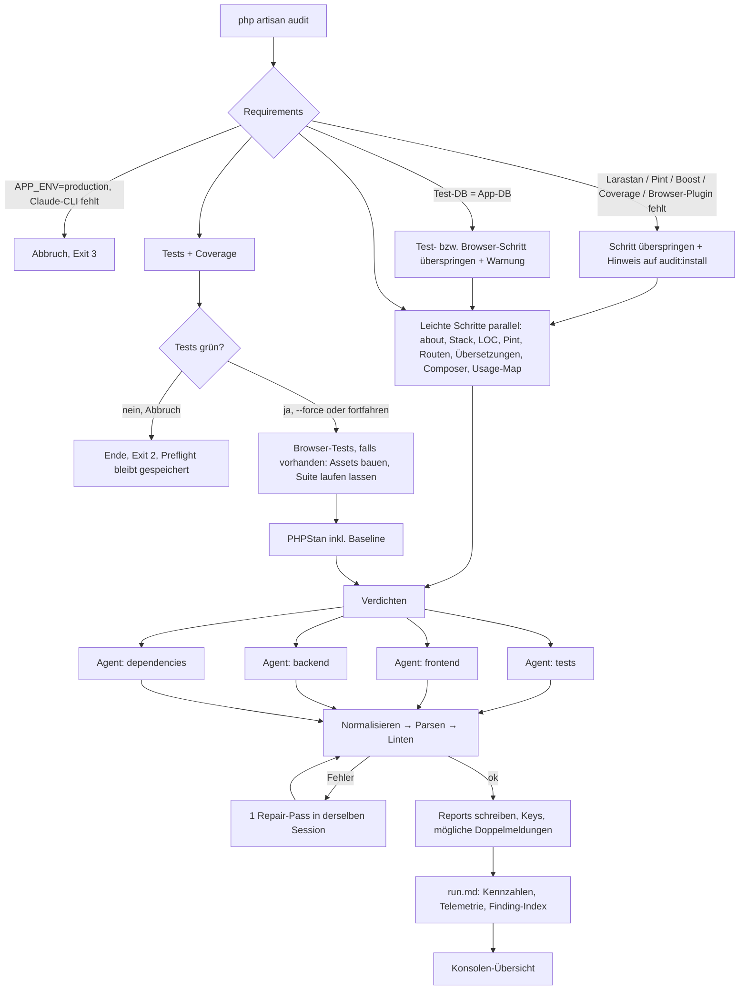

# astro2006/laravel-audit – MVP1

> Status: Entwurf v3 · 11.09.2026 · Basis: `CONCEPT.md` v0.1
>
> `CONCEPT.md` bleibt die Zielvision. Dieses Dokument legt fest, was davon in MVP1 gebaut wird und was sich dabei ändert. **Was hier nicht steht, ist nicht Teil von MVP1.**

## 1. Ziel

MVP1 liefert das Werkzeug für den Alltag: installieren, alle vier Audits laufen lassen, Reports lesen. Gleichzeitig beantwortet MVP1 die Frage, auf der alles Weitere aufbaut:

> Liefern Agents auf Basis eines deterministischen Preflights Findings, die präzise, stabil und ihre Kosten wert sind?

Dafür braucht es drei Dinge, die im Gesamtkonzept fehlen oder zu spät kommen: eine **Fixture-App mit bekannten Schwachstellen**, **Messung von Tokens und Kosten** und **stabile Finding-Schlüssel**.

Umfang:

- `php artisan audit:install`: fehlende Pakete sammeln, um Erlaubnis fragen, installieren (siehe 5)
- Alle 4 Audits: `tests`, `frontend`, `backend`, `dependencies`
- Preflight mit Lint, Tests + Coverage, Browser-Tests (Playwright über das Pest-Browser-Plugin, Pest 4+; gibt es keine, entfällt der Schritt), PHPStan, Composer. Die Agents bekommen nur die Ergebnisse.
- 1 Agent-Driver: Claude Code
- Keine Summary, keine Historie, keine Note

## 2. Leitprinzipien (geschärft)

| Prinzip | Bedeutung in MVP1 |
|---|---|
| Messen vor Denken | Alles, was sich berechnen lässt, berechnet der Harness: Test- und Browser-Ergebnisse, Coverage pro Klasse, Routen-Auffälligkeiten, Übersetzungslücken, Dependency-Fakten. Kein Agent bekommt eine Shell. |
| Nichts ohne Zustimmung | Pakete installiert nur `audit:install`, und nur nach Ja. `php artisan audit` installiert nie etwas. |
| Read-only, erzwungen | Schreibrechte, Shell, Tinker und `.env`-Dateien sind per CLI-Rechten gesperrt, nicht nur per Prompt. |
| Der Harness besitzt die Metadaten | Frontmatter, Zeitstempel, Modell, Kennzahlen und Sortierung kommen vom Harness. Der Agent liefert nur Inhalt. |
| Ownership über Checks | Jeder Check-Slug gehört genau einem Audit. Überschneidungen sind damit strukturell ausgeschlossen, nicht nur per Verzeichnis-Regel. |
| Sicher für die Umgebung | Kein Run in Production. Tests und Browser-Tests laufen nur, wenn ihre Datenbank nachweislich nicht die App-Datenbank ist. |
| Messbar | Jeder Run protokolliert Tokens, Kosten, Turns und Dauer pro Agent. Jede Prompt-Änderung lässt sich gegen die Fixture messen. |

### 2.1 Behobene Schwachstellen

Die kritischen Punkte aus der Analyse von `CONCEPT.md` und wo MVP1 sie löst:

| # | Schwachstelle in CONCEPT.md | Fix in MVP1 | Abschnitt |
|---|---|---|---|
| 1 | „Read-only“ nur per Prompt: Boost-Tinker führt beliebiges PHP aus, `.env` ist lesbar, User-Config, Hooks und andere MCP-Server laden mit | CLI-Rechte: keine Schreib-Tools, keine Shell, eigene MCP-Config nur mit Boost, Tool-Allowlist ohne Tinker, Deny-Regeln für jede `.env*`-Datei | 8.1 |
| 2 | Score unnormalisiert (große Apps landen bei 0) und nur scheinbar deterministisch, weil der Input schwankt | Keine Note. Deterministische Messwerte plus experimentelle Risikopunkte pro 1.000 LOC. Die Eval misst zuerst die Varianz. | 10.2, 11 |
| 3 | Zuordnung über Runs instabil (Kategorie, erste Location und Titel schwanken) | Pflichtfeld `Check` aus fester Liste, Key über alle Location-Ziele | 9.2, 9.6 |
| 4 | Überschneidende Zuständigkeiten zwischen frontend, backend und tests; das Hauptbeispiel BE-003 verletzt die eigene Regel | Ownership über Check-Slugs, Grenzfall-Tabelle, Beobachtungen außerhalb des eigenen Scopes nur als ungezählte Notiz | 9.3, 9.4 |
| 5 | `Related` über Audits hinweg ist unmöglich, weil die Agents parallel laufen | `Related` nur im eigenen Report | 9.2 |
| 6 | Dedup nach dem Scoring: Duplikate kosten doppelt | Kein Gesamt-Score. Der Harness markiert mögliche Doppelmeldungen deterministisch über überlappende Locations. Echte Dedup kommt mit der Summary (v0.2). | 9.5, 10.1 |
| 7 | Agents sollen `Audit/` ignorieren, lesen dort aber ihre Eingaben | `storage/audit`, mit ausdrücklicher Ausnahme für `{{preflight_dir}}` | 10, 12 |
| 8 | Agent schreibt Modellnamen und Zeitstempel, die er nicht zuverlässig kennt | Frontmatter und H1 kommen vom Harness | 9.1 |
| 9 | Boost-Guideline wirkt auf jeden Alltags-Agent im Projekt, Boost ist Pflicht | Keine Guideline. Boost wird bei der Installation empfohlen, ist für den Audit aber optional. | 5.1, 6, 8.1 |
| 10 | Tests laufen parallel mit PHPStan und Browser-Tests: Ressourcen-Konkurrenz, doppelte Browser-Läufe, Risiko für die Dev-DB, kein Production-Schutz, fehlendes paratest | Schwere Schritte nacheinander (Tests → Gate → Browser → PHPStan), DB-Guard für Tests und Browser-Tests, Browser-Suite läuft nur im eigenen Schritt, Assets vom Harness, paratest im Installer, Production-Guard | 6, 7.2–7.4 |
| 11 | Verdichtung reicht nicht: `junit.xml`/`coverage.xml` können mehrere MB groß sein, Routen- und Dependency-Fakten bleiben dem Agent überlassen | `tests-condensed`, `browser-condensed`, `coverage-by-class`, `route-test-map`, `route-facts`, `lang-diff`, `dependency-facts`; Linter prüft Abdeckung von Advisories, Test-Fehlschlägen und Baseline | 7.7, 7.9, 9.5 |
| 12 | Abgeschnittene Reports und ein teurer Repair, der den kompletten Report neu erzeugt | Normalizer ohne LLM, Repair in derselben Session, `max_findings`, Erkennung abgeschnittener Antworten | 8.4, 9.5 |
| 13 | Qualität und Kosten der Findings werden nirgends gemessen | Telemetrie pro Agent, Fixture-App, `audit:eval`, Erfolgskriterien | 8.2, 10.1, 11 |
| 14 | Installer: `composer require` ändert evtl. mehr als angezeigt, neue Pakete sind im laufenden Prozess nicht ladbar, `boost:install` braucht ein Terminal | Vorschau per `--dry-run` mit Rückfrage bei zusätzlichen Updates, Installation und erneute Prüfung in eigenen Prozessen, TTY-Übergabe mit Fallback | 5.2 |
| 15 | Kleinere Widersprüche: Repair-Pass im Prompt, aber auf der v0.2-Roadmap; Larastan bricht ab, Pint wird nur übersprungen; Stub-Level 9; `--skip-preflight` undefiniert | Repair in MVP1; fehlendes Larastan überspringt nur PHPStan; Stub-Level 5 (konfigurierbar); `--reuse-preflight` mit festen Regeln | 4.1, 5.2, 6, 7.6, 8.4 |

## 3. Ablauf



Beispiel-Ausgabe (Zahlen sind Beispielwerte):

```
$ php artisan audit

 laravel-audit 0.1 · Run 2026-10-02_09-15-40 · Agent: claude (claude-opus-5) · Browser: Playwright

 Requirements
  ✔ Claude Code CLI
  ✔ Boost-MCP (5 Tools freigegeben)
  ✔ Larastan (phpstan.neon, Level 6, Baseline mit 212 Einträgen)
  ✔ Coverage-Treiber: pcov
  ✔ Test-Datenbank: sqlite :memory: (getrennt von der App-DB)
  ✔ Browser: Pest-Browser-Plugin + Playwright (18 Tests in Suite „Browser“)

 Preflight
  ✔ about, Stack ........ Laravel 12.x · PHP 8.4 · Livewire, Alpine, Tailwind · 18.240 LOC
  ✔ Pint ................ 7 Dateien, 4 Regeln
  ✔ Routen .............. 96 (11 Auffälligkeiten)
  ✔ Übersetzungen ....... de, en · 14 fehlende Keys
  ✔ Composer ............ 2 Advisories, 1 abandoned, 3 Major-Updates
  ✘ Tests ............... 3/412 fehlgeschlagen · Coverage 71,4 %

  3 Tests schlagen fehl. Trotzdem mit den Audits fortfahren? (yes/no) [no]
  › yes

  ✘ Browser (Playwright)  1/18 fehlgeschlagen · 1 Screenshot
  ✔ PHPStan (Level 6) ... 38 Fehler + 212 in der Baseline

 Agents
  ✔ tests .......... 15 Findings · 64 Turns · 2,6 M in / 25 k out · $3.00 · 8m40s
  ✔ frontend ....... 12 Findings · 55 Turns · 2,1 M in / 22 k out · $2.40 · 7m10s
  ✔ backend ........ 17 Findings · 42 Turns · 1,9 M in / 21 k out · $2.10 · 6m12s
  ✔ dependencies ...  7 Findings · 12 Turns · 0,3 M in /  6 k out · $0.41 · 1m48s · 1 Repair

 Findings: Critical 1 · High 7 · Medium 24 · Low 15 · Info 4 · 2 mögliche Doppelmeldungen
 → storage/audit/2026-10-02_09-15-40/run.md
```

## 4. Commands

| Command | Wirkung |
|---|---|
| `php artisan audit` | Alle aktiven Audits (`config('audit.audits')`) |
| `--tests` / `--frontend` / `--backend` / `--dependencies` | Nur die genannten Audits (kombinierbar) |
| `--force` | Test-Gate überspringen (fortfahren trotz fehlschlagender Tests) |
| `--without=<werte>` | Audits oder Preflight-Schritte für diesen Run auslassen, z. B. `--without=frontend` oder `--without=browser` (siehe 4.2) |
| `--preflight-only` | Nur Preflight, keine Agents, 0 Tokens |
| `--reuse-preflight[=RUN_ID]` | Preflight aus einem früheren Run übernehmen (siehe 4.1) |
| `php artisan audit:install [--dry-run] [--yes]` | Setup: fehlende Pakete sammeln, um Erlaubnis fragen, installieren, Config (siehe 5) |
| `php artisan audit:eval <expected.json> [--runs=3]` | Entwickler-Command (hidden): Runs gegen die Fixture auswerten (siehe 11) |

Exit-Codes von `php artisan audit`:

| Code | Bedeutung |
|---|---|
| `0` | Alle gewählten Audits haben einen gültigen Report |
| `1` | reserviert für `--fail-on` (später) |
| `2` | Am Test-Gate abgebrochen |
| `3` | Harness-Fehler oder mindestens ein Audit gescheitert |

### 4.1 `--reuse-preflight`

Ersetzt `--skip-preflight` und legt fest, was vorher offen war:

- Ohne Wert: der jüngste Run, dessen `run.md` einen vollständigen Preflight meldet. Mit Wert: genau dieser Run.
- Es entsteht ein **neuer** Run-Ordner. Der alte `preflight/` wird kopiert (kein Symlink, wegen Windows).
- `run.md` bekommt `preflight_from: <run_id>`.
- Weichen `git_commit` oder `git_dirty` vom aktuellen Stand ab: Warnung, kein Abbruch.
- Fehlt im alten Preflight ein Schritt, den ein gewähltes Audit braucht: Abbruch, Exit 3.
- Das Test-Gate wird auf Basis der gespeicherten Ergebnisse erneut ausgewertet.

### 4.2 `--without`

Lässt Audits oder einzelne Preflight-Schritte für diesen Run aus, ohne die Config zu ändern. Mehrere Werte per Komma oder durch Wiederholen der Option:

```bash
php artisan audit --without=frontend              # alles außer dem Frontend-Audit
php artisan audit --without=browser               # alle Audits, aber keine Browser-Tests (z. B. Playwright kaputt)
php artisan audit --without=frontend,browser      # beides
php artisan audit --backend --tests --without=phpstan
```

| Wert | Wirkung |
|---|---|
| `tests`, `frontend`, `backend`, `dependencies` | Das Audit entfällt. Preflight-Schritte, die nur dieses Audit braucht, entfallen mit (z. B. `--without=dependencies` → kein Composer-Schritt). |
| `browser` | Der Browser-Schritt entfällt. `tests` und `frontend` laufen ohne Browser-Ergebnisse. |
| `phpstan` | PHPStan entfällt. `tests` ohne PHPStan-Teil, `backend` ohne PHPStan-Belege. |
| `pint` | Der Lint-Schritt entfällt. |
| `coverage` | Tests laufen ohne Coverage (deutlich schneller, vor allem mit Xdebug). |

Regeln:

- Zuerst wird ausgewählt (aktive Audits aus der Config bzw. `--tests`, `--frontend` …), danach zieht `--without` ab.
- **`--without=frontend` stoppt die Browser-Tests nicht**, solange `tests` läuft, weil auch das Tests-Audit sie nutzt. Funktioniert Playwright nicht, ist `--without=browser` der richtige Schalter. Die Warnung beim fehlgeschlagenen Browser-Schritt nennt ihn.
- Fehler mit Exit 3:
  - ein Audit ist gleichzeitig gewählt und ausgeschlossen (`--frontend --without=frontend`)
  - es bleibt kein Audit übrig
  - unbekannter Wert (die Meldung listet die erlaubten Werte)
- Ausgelassene Schritte stehen in `summary.json` als `"status": "skipped", "reason": "without"`. Die betroffenen Agents vermerken das unter „Limitations“, und `run.md` bekommt `without: frontend, browser`.
- Die Konsole zeigt die ausgelassenen Teile im Header, z. B. `Ohne: frontend, browser`.

## 5. Installation: `php artisan audit:install`

Grundregel wie im Gesamtkonzept: **Alles, was gebraucht wird, kommt bei `audit:install`, und zwar nur mit Zustimmung.** `php artisan audit` installiert nie etwas, sondern verweist bei fehlenden Teilen auf `audit:install`.

Der Installer wird gebaut, sobald `php artisan audit` läuft (siehe 15). Er nutzt dieselben Requirement-Klassen wie der Check beim Audit.

### 5.1 Was geprüft wird

| Paket | Wofür | Nötig wenn |
|---|---|---|
| `laravel/boost` (composer, dev) | Kontext für die Agents (MCP: Schema, Routen, Doku-Suche) | empfohlen; der Audit läuft auch ohne |
| `larastan/larastan` (composer, dev) | Statische Analyse mit PHPStan | Audits `tests` oder `backend` aktiv |
| `laravel/pint` (composer, dev) | Lint-Schritt | Audit `backend` aktiv |
| `brianium/paratest` (composer, dev) | parallele Tests | Audit `tests` aktiv und das Projekt nutzt nur PHPUnit (Pest bringt es mit) |
| `pestphp/pest-plugin-browser` (composer, dev) | Browser-Tests mit Playwright | Audit `tests` oder `frontend` aktiv |
| `pestphp/pest` (composer, dev) | Voraussetzung für das Browser-Plugin | wie oben, und das Projekt nutzt nur PHPUnit |
| `playwright` (npm, dev) + Browser-Binaries | Browser-Engine | wie oben |

Welche Audits aktiv sind, kommt aus `config('audit.audits')`. Wer `backend` nie laufen lässt, wird nicht nach Pint gefragt.

**Browser-Tests:** MVP1 unterstützt nur Playwright über das Pest-Browser-Plugin (Pest 4+). Dusk ist die ältere Lösung und entfällt. Das Plugin wird auch angeboten, wenn das Projekt noch keine Browser-Tests hat. Der Hinweis in der Liste sagt dann: „Noch keine Browser-Tests, der Browser-Schritt wird übersprungen, bis es welche gibt.“

**Sonderfälle** mit eigenem Hinweis in der Liste:

- **Nur PHPUnit:** Das Browser-Plugin braucht Pest. Pest führt bestehende PHPUnit-Tests unverändert mit aus, trotzdem ist das eine spürbare Änderung am Projekt. Deshalb wird Pest als „Upgrade“ markiert.
- **Pest-Version zu alt für das Browser-Plugin** (vor Pest 4): Das wäre ein Major-Upgrade. Es wird als „Upgrade“ markiert.
- „Upgrade“-Pakete sind nie in „Ja, alle“ oder `--yes` enthalten, sondern werden einzeln abgefragt. Wird das Upgrade abgelehnt, entfallen auch Plugin und Playwright aus dem Plan.
- **PHP-Version zu alt für das Plugin:** Browser-Pakete entfallen aus dem Plan, mit Hinweis auf die nötige PHP-Version. (Pest 4: PHP ≥ 8.3, Pest 5: PHP ≥ 8.4; gegen die Pest-Doku prüfen.)

**Was nicht installiert werden kann** (nur Hinweise mit Anleitung, am Ende der Ausgabe): Coverage-Treiber (pcov oder xdebug), Claude Code CLI, Node/npm.

**Umgebungs-Checks ohne Installation** (ebenfalls Hinweise am Ende):

- Test-Datenbank = App-Datenbank → der Audit würde die Tests überspringen (siehe 7.3). Der Hinweis nennt die `phpunit.xml`-Einträge.

### 5.2 Ablauf

1. Config `config/audit.php` publishen.
2. Alle Voraussetzungen prüfen und daraus einen Installationsplan bauen.
3. Plan anzeigen: fehlende Pakete mit Zweck, danach die exakten Befehle.
4. Zustimmung einholen: **Ja, alle** · **Auswählen** (Liste, alles vorausgewählt, einzelne abwählbar) · **Nein**.
5. **Composer-Vorschau:** `composer require --dev … --dry-run`. Würde Composer außer den neuen Paketen weitere Pakete aktualisieren oder entfernen, zeigt der Installer sie an und fragt noch einmal. Ohne solche Nebenwirkungen gibt es keine zweite Frage.
6. Ausführen, gebündelt und jeweils in einem eigenen Prozess:
   - ein einziges `composer require --dev …` für alle Composer-Pakete
   - ein `npm install --save-dev …` (pnpm, yarn oder bun, falls deren Lockfile existiert)
   - Setup-Schritte:
     - `phpstan.neon` aus dem Stub (nur wenn weder `phpstan.neon` noch `phpstan.neon.dist` existiert), mit Level aus `preflight.phpstan.stub_level` (Default 5)
     - `php artisan boost:install` interaktiv mit Terminal-Übergabe. Ohne Terminal (z. B. in CI) wird der Befehl als „manuell erledigen“ gelistet.
     - `npx playwright install`
7. **Erneut prüfen, in einem neuen PHP-Prozess.** Der laufende Prozess kennt die gerade installierten Pakete nicht, weil sein Autoloader beim Start geladen wurde.
8. `storage/audit/.gitignore` anlegen (`*` und `!.gitignore`). Die Projekt-`.gitignore` bleibt unverändert.
9. Abschlussübersicht: installiert, abgelehnt (mit Konsequenz, z. B. „Ohne Larastan läuft PHPStan nicht, `tests` und `backend` arbeiten ohne“), manuell zu erledigen, Umgebungs-Hinweise.

Warum Stub-Level 5 statt 9: Auf einem Projekt, das noch nie analysiert wurde, erzeugt Level 9 tausende Fehler, fast nur `mixed`-Rauschen. Das macht PHPStan langsam und den Tests-Report unbrauchbar. Wer mehr will, erhöht das Level in `phpstan.neon`; der Audit übernimmt es beim nächsten Run.

### 5.3 Beispiel

```
$ php artisan audit:install

 laravel-audit · Setup

 Bereits vorhanden
  ✔ laravel/pint
  ✔ pestphp/pest

 Ich brauche diese Pakete:

  larastan/larastan ............. Statische Analyse (tests, backend)    composer --dev
  laravel/boost ................. Kontext für die Agents (MCP)          composer --dev
  pestphp/pest-plugin-browser ... Browser-Tests mit Playwright          composer --dev
  playwright .................... Browser-Engine (~ mehrere 100 MB)    npm --save-dev

 Dafür würde ich ausführen:
  composer require --dev larastan/larastan laravel/boost pestphp/pest-plugin-browser
  npm install --save-dev playwright@latest
  npx playwright install
  php artisan boost:install    (interaktiv)

 Darf ich diese Pakete installieren?
  › Ja, alle
    Auswählen
    Nein

 …

 Fertig.
  ✔ 4 Pakete installiert, phpstan.neon erstellt (Level 5), storage/audit/.gitignore angelegt
  ⚠ Kein Coverage-Treiber aktiv → z. B. `pecl install pcov`
  ⚠ Tests würden gegen die App-Datenbank laufen → in phpunit.xml DB_CONNECTION=sqlite und DB_DATABASE=:memory: setzen
  ⚠ Agent-CLI `claude` nicht im PATH → siehe Claude-Code-Doku
```

Würde Composer zusätzlich bestehende Pakete ändern, erscheint nach der Zustimmung:

```
 Composer würde außerdem aktualisieren:
  symfony/process ........ 7.3.0 → 7.3.4
 Trotzdem fortfahren? (yes/no) [yes]
```

### 5.4 Nicht-interaktiv und Idempotenz

- `--dry-run`: nur anzeigen, was fehlt und was ausgeführt würde.
- `--no-interaction` ohne `--yes`: nichts installieren, Plan ausgeben, Exit 1, falls etwas Nötiges fehlt.
- `--yes`: alles aus dem Plan installieren, außer als „Upgrade“ markierten Paketen. Die brauchen immer eine explizite Zustimmung. Die Composer-Vorschau aus 5.2 wird dann nur ausgegeben, nicht abgefragt.
- Der Command kann jederzeit erneut laufen, z. B. nach dem Aktivieren weiterer Audits. Bestehende Configs (`phpstan.neon`, `boost.json`) werden nie überschrieben.

## 6. Requirements bei `php artisan audit`

| Check | Wenn fehlt / verletzt |
|---|---|
| `app()->environment('production')` | Abbruch, Exit 3. Kein Override. |
| Claude-CLI im PATH (`agent.binary`) | Abbruch, Exit 3, mit Install-Hinweis (außer bei `--preflight-only`) |
| `composer --version` | Abbruch, wenn `dependencies` gewählt ist |
| Output-Ordner beschreibbar | Abbruch, Exit 3 |
| Test-Datenbank ≠ App-Datenbank (siehe 7.3) | Test-Schritt überspringen, deutliche Warnung. Das Tests-Audit läuft ohne Ergebnisse, nur statisch. |
| Browser-Tests vorhanden (siehe 7.4) | Keine Browser-Tests → Browser-Schritt entfällt still (nur Info-Zeile, keine Warnung) |
| Browser-Plugin + Playwright installiert (siehe 7.4) | Browser-Tests vorhanden, aber Plugin oder Playwright fehlt → Browser-Schritt überspringen, Hinweis `php artisan audit:install` |
| Coverage-Treiber (`pcov` oder `xdebug` in `php -m`) | Tests ohne Coverage, Hinweis. Das Tests-Audit weiß: Coverage unbekannt. |
| `brianium/paratest` (nur bei reinem PHPUnit) | Tests ohne `--parallel`, Hinweis `php artisan audit:install` |
| `larastan/larastan` + `phpstan.neon(.dist)` | PHPStan-Schritt überspringen, Hinweis `php artisan audit:install`. Kein Abbruch. |
| `vendor/bin/pint` | Pint-Schritt überspringen, Hinweis `php artisan audit:install` |
| Laravel Boost (`laravel/boost` + MCP-Eintrag in `.mcp.json`) | Agents laufen ohne Boost-MCP, Hinweis `php artisan audit:install` |

Unterstützt: Laravel 12 und 13, PHP ≥ 8.2. Browser-Tests brauchen das Pest-Browser-Plugin (Pest 4: PHP ≥ 8.3, Pest 5: PHP ≥ 8.4). (Matrix vor Release gegen die Laravel- und Pest-Doku prüfen.)

## 7. Preflight

### 7.1 Schritte

| Schritt | Befehl / Quelle | Output unter `preflight/` | tests | frontend | backend | dependencies |
|---|---|---|:-:|:-:|:-:|:-:|
| App-Info | `php artisan about --json` | `about.json` | ✓ | ✓ | ✓ | ✓ |
| Stack | `composer.json`, `package.json` (Livewire, Inertia, Vue/React, Filament, Alpine, Tailwind, Pest/PHPUnit) | in `summary.json` | ✓ | ✓ | ✓ | ✓ |
| LOC | nicht-leere Zeilen in `app/**/*.php` | in `summary.json` | ✓ | ✓ | ✓ | ✓ |
| Pint | `vendor/bin/pint --test --format=json` | `pint.json`, `pint-grouped.json` | | | ✓ | |
| Routen | `php artisan route:list --json` | `routes.json`, `route-facts.json` | ✓ | ✓ | ✓ | |
| Übersetzungen | `lang/**` (PHP- und JSON-Dateien) vergleichen | `lang-diff.json` | | ✓ | | |
| Tests | `php artisan test` mit JUnit und Clover (siehe 7.3) | `tests/junit.xml`, `tests/coverage.xml`, `tests/tests-condensed.json`, `tests/coverage-by-class.json`, `tests/route-test-map.json` | ✓ | | | |
| Browser | `php artisan test --testsuite=Browser …`, nur wenn Browser-Tests existieren (siehe 7.4) | `tests/browser-junit.xml`, `tests/browser-condensed.json`, `tests/browser-artifacts/` | ✓ | ✓ | | |
| PHPStan | `vendor/bin/phpstan analyse --error-format=json --no-progress --memory-limit=…` mit Projekt-Config, dazu Baseline auslesen (siehe 7.6) | `phpstan/phpstan.json`, `phpstan/phpstan-grouped.json` | ✓ | | ✓ | |
| Composer | `audit --format=json --locked` · `show --direct --format=json` · `outdated --direct --format=json` · `licenses --format=json` · `validate --no-check-publish` · `why` / `depends` für jedes auffällige Paket | `composer/*.json`, `composer/validate.txt` | | | | ✓ |
| Usage-Map | Package-Skript (siehe 7.8) | `composer/usage-map.json` | | | | ✓ |
| Dependency-Fakten | aus Composer + Usage-Map (siehe 7.9) | `composer/dependency-facts.json` | | | | ✓ |

Bei Einzelaufrufen läuft nur, was die gewählten Audits brauchen. `php artisan audit --frontend` startet also keine Unit-/Feature-Tests und kein PHPStan, aber die Browser-Tests. Mit `--without` lassen sich zusätzlich einzelne Schritte auslassen (siehe 4.2).

Wie im Gesamtkonzept gilt: **Exit-Codes der Tools sind Daten.** Ein Schritt ist nur gescheitert, wenn kein verwertbarer Output entsteht. Dann `"status": "error"` in `summary.json`, und das Audit läuft weiter.

### 7.2 Reihenfolge

Tests, Browser-Tests und PHPStan sind ressourcenintensiv und bremsen sich gegenseitig aus, wenn sie gleichzeitig laufen. Deshalb gibt es zwei Stränge:

- **Leicht, parallel:** about, Stack, LOC, Pint, Routen, Übersetzungen, Composer, Usage-Map, Fakten
- **Schwer, nacheinander:** Tests → Test-Gate → Browser → PHPStan

Beide Stränge starten gleichzeitig. Das Gate steht vor den Browser-Tests, weil sich eine kaputte Umgebung fast immer schon bei den schnellen Tests zeigt. Bricht der Nutzer ab, laufen Browser-Tests und PHPStan nicht mehr, und die bis dahin erzeugten Preflight-Dateien bleiben erhalten.

Ist `tests` nicht gewählt, entfällt das Gate. Bei `--frontend` besteht der schwere Strang dann nur aus den Browser-Tests, bei `--backend` läuft PHPStan im leichten Strang mit.

### 7.3 Test-Schritt

**Test-DB-Guard.** Tests mit `RefreshDatabase` löschen die Datenbank, gegen die sie laufen. Bei einer falsch konfigurierten `phpunit.xml` ist das die Dev-Datenbank. Vor dem Test-Schritt ermittelt der Harness deshalb die Test-Verbindung:

1. `<env>`-Einträge `DB_CONNECTION`, `DB_DATABASE`, `DB_HOST` in `phpunit.xml` bzw. `phpunit.xml.dist`
2. sonst `.env.testing`
3. sonst `.env`

Zeigt das Ergebnis auf dieselbe Verbindung, denselben Host und dieselbe Datenbank wie die App und ist es nicht `sqlite` mit `:memory:`, wird der Test-Schritt übersprungen (`"status": "skipped", "reason": "shared-database"`). Override nur bewusst über `preflight.allow_shared_database = true`. Die Heuristik entscheidet im Zweifel für „nicht ausführen“.

**Befehl.** Standard:

```bash
php artisan test --parallel --log-junit=… --coverage-clover=… --exclude-testsuite=Browser
```

- `--parallel` nur, wenn Pest genutzt wird oder `brianium/paratest` installiert ist
- `--coverage-clover` nur mit Coverage-Treiber. Bei Xdebug setzt der Harness `XDEBUG_MODE=coverage`.
- `--exclude-testsuite` für die Browser-Suite (`preflight.browser.testsuite`), falls sie in der `phpunit.xml` existiert. Die Browser-Tests laufen so nicht doppelt, sondern nur im Browser-Schritt.
- Mit `preflight.tests.command` lässt sich der Befehl komplett ersetzen

### 7.4 Browser-Schritt

Vorhandene Browser-Tests laufen im Preflight. Die Agents bekommen nur die Ergebnisse, Screenshots und Konsolen-Logs.

MVP1 unterstützt nur **Playwright über das Pest-Browser-Plugin** (Pest 4+). Dusk entfällt.

**Entscheidung, ob der Schritt läuft:**

| Situation | Ergebnis |
|---|---|
| `--without=browser` oder `preflight.browser.enabled = false` | Schritt entfällt (`reason: without` bzw. `disabled`) |
| Keine Browser-Tests: weder eine Testsuite `preflight.browser.testsuite` (Default `Browser`) in der `phpunit.xml` noch Testdateien in `preflight.browser.path` (Default `tests/Browser`) | Schritt entfällt still (`reason: no-browser-tests`). Nur eine Info-Zeile, keine Warnung. Das Tests-Audit bewertet dann, ob Browser-Tests fehlen. |
| Browser-Tests vorhanden, aber `pestphp/pest-plugin-browser` oder `node_modules/playwright` fehlt | Schritt überspringen (`reason: plugin-missing`), Warnung mit `php artisan audit:install` und `--without=browser` |
| Browser-Tests vorhanden, Test-DB = App-DB (siehe 7.3) | Schritt überspringen (`reason: shared-database`) |
| sonst | Schritt läuft |

**Befehl:** `php artisan test --testsuite=Browser --log-junit=…`, falls die Suite existiert, sonst `php artisan test tests/Browser --log-junit=…`. Überschreibbar mit `preflight.browser.command`. Ein fehlender Schritt bricht nie den ganzen Run ab.

**Assets.** Browser-Tests brauchen gebaute Frontend-Assets. Fehlt `public/build/manifest.json`, führt der Harness den Build-Befehl des Projekts aus (`npm run build`, bzw. pnpm, yarn oder bun je nach Lockfile). Gesteuert über `preflight.browser.build_assets`: `if-missing` (Default) | `always` | `never`. Das schreibt nur ins Build-Verzeichnis und steht im Log. Ist das Manifest älter als die neueste Datei in `resources/js` oder `resources/css`, gibt es eine Warnung, dass gegen veraltete Assets getestet wird.

**App-Server und Datenbank.** Das Pest-Browser-Plugin bringt seinen Server selbst mit und läuft in der Test-Umgebung. Deshalb gilt derselbe DB-Guard wie in 7.3, ein eigener App-Server ist nicht nötig.

**Ergebnisse und Artefakte.** JUnit nach `tests/browser-junit.xml`. Screenshots, die während des Laufs entstanden sind (Screenshot-Verzeichnis des Plugins, Default `tests/Browser/Screenshots`), kopiert der Harness nach `tests/browser-artifacts/`: nur Dateien aus diesem Lauf, maximal `preflight.browser.max_artifacts` (Default 10). Claude Code kann Bilder lesen, die Agents sehen also die Screenshots fehlgeschlagener Tests.

**Kein Gate.** Browser-Fehlschläge sind Ergebnisse, kein Abbruchgrund. Schlagen mehr als 90 % mit demselben Fehler fehl (Server nicht erreichbar, Assets fehlen, Browser startet nicht), markiert der Harness den Schritt als `environment-error`. Die Agents behandeln die Ergebnisse dann als unzuverlässig.

### 7.5 Test-Gate

Wie CONCEPT 7.4:

1. Alles grün → weiter.
2. Fehler → Übersicht: `x/y fehlgeschlagen`, die ersten 5 Testnamen, häufigste Exception.
3. Heuristik „Umgebung kaputt“: mehr als 90 % rot mit derselben Exception (z. B. DB-Verbindung, fehlender `APP_KEY`) → deutliche Warnung, dass ein Audit hier keinen Sinn ergibt.
4. Frage „Trotzdem fortfahren?“, Default **Nein**.
5. `--force` überspringt die Frage. `--no-interaction` ohne `--force` bricht ab (Exit 2), damit CI keine Tokens verbrennt.
6. Konfigurierbar als `preflight.tests.gate`: `ask` | `abort` | `continue`.

Das Gate greift nur, wenn der Test-Schritt gelaufen ist. Browser-Fehlschläge lösen es nicht aus (siehe 7.4).

### 7.6 PHPStan

- **Level:** Eine vorhandene `phpstan.neon(.dist)` wird unverändert genutzt, ohne `--level`. Das Level wird bei jedem Run frisch ausgelesen, bevorzugt über `vendor/bin/phpstan dump-parameters --json`, sonst per NEON-Parser über die Config und ihre `includes`. Nicht gefunden → `unknown`. Ein bewusster Override ist über `preflight.phpstan.level` möglich. (Wie CONCEPT 7.7.)
- **Baseline:** Einträge aus der Baseline-Datei (NEON- oder PHP-Format) landen als `baselined` in `phpstan-grouped.json`. Das braucht keinen zweiten PHPStan-Lauf. (Wie CONCEPT 7.6.) Baseline-Einträge haben keine Zeilennummern, deshalb gruppiert der Harness sie nach Identifier (falls vorhanden), Datei und Anzahl.
- **Keine Config:** Schritt überspringen, Hinweis `php artisan audit:install` (legt den Stub an, siehe 5.2). Der Audit selbst legt nichts an.

NEON wird mit `nette/neon` gelesen (Dependency des Packages).

### 7.7 Verdichtung

Agents lesen zuerst die verdichteten Dateien. Die Rohdaten bleiben für Details verfügbar.

| Datei | Inhalt |
|---|---|
| `summary.json` | wie CONCEPT 7.5, plus `loc`, Status jedes Schritts inkl. Grund beim Überspringen, DB-Guard-Entscheidungen |
| `pint-grouped.json` | Regel → Anzahl Dateien, 5 Beispieldateien |
| `phpstan-grouped.json` | Identifier → Anzahl, Top-Dateien, 3 Beispiele; Baseline-Einträge als `baselined` |
| `tests/tests-condensed.json` | Summen, Fehlschläge gruppiert nach Exception und Meldung, übersprungene Tests mit Grund, die 10 langsamsten Tests |
| `tests/browser-condensed.json` | wie `tests-condensed.json`, plus `environment_error`, Artefakt-Pfade pro fehlgeschlagenem Test und pro Testdatei die besuchten URIs (statisch aus `visit(…)`-Aufrufen), damit Journeys gegen `routes.json` abgeglichen werden können |
| `tests/coverage-by-class.json` | pro Klasse in `app/`: Zeilen-Coverage, nicht abgedeckte Methoden. Aufsteigend sortiert, damit die Lücken oben stehen. |
| `tests/route-test-map.json` | pro Route: Tests, die Routen-Namen (`route('…')`), URI-Literal oder Controller-Klasse referenzieren, inklusive Browser-Tests. Heuristik, der Agent prüft nach. |
| `route-facts.json` | Kandidaten (keine Findings): nicht-GET-Routen ohne `auth`-Middleware, GET-Routen mit schreibenden Action-Namen (`store`, `update`, `destroy`, `delete`), Auth- und Formular-Routen ohne `throttle`, bekannte Debug-/Tooling-Routen (Telescope, Horizon, Pulse, Log-Viewer, `phpinfo`), Routen mit fehlender Controller-Methode |
| `lang-diff.json` | pro Locale fehlende Keys im Vergleich zur Default-Locale |

Beispiel `tests-condensed.json`:

```json
{
  "status": "ok", "total": 412, "passed": 405, "failed": 3, "errors": 0, "skipped": 4, "duration_s": 38.2,
  "failure_groups": [
    { "exception": "ErrorException", "message": "Undefined array key \"discount\"", "count": 2,
      "tests": ["Tests\\Feature\\CheckoutTest::it applies coupon", "Tests\\Feature\\CheckoutTest::it rejects expired coupon"] }
  ],
  "skipped": [ { "test": "Tests\\Feature\\ExportTest::it exports csv", "reason": "TODO after refactor" } ],
  "slowest": [ { "test": "Tests\\Feature\\ReportTest::it builds yearly report", "seconds": 4.1 } ]
}
```

### 7.8 Usage-Map

Pro direktem Composer-Paket: PSR-4-Namespaces (aus `vendor/composer/installed.json`), Referenzen getrennt nach Prod-Code (`app/`, `config/`, `database/`, `routes/`, `bootstrap/`, `resources/views`) und `tests/`, Top-5-Dateien, auto-discoverte Provider/Aliases (`extra.laravel`), Binaries in `composer.json`-Scripts, `package.json`-Scripts und `.github/workflows/*`.

Erkennung über `token_get_all()` (`use`-Statements und voll qualifizierte Namen), Blade-Dateien per Regex. Globale Helper-Funktionen aus `files`-Autoloads werden in MVP1 nicht erkannt. Das steht als bekannte Grenze in der Usage-Map und damit auch im Prompt.

### 7.9 Dependency-Fakten

Der Dependencies-Audit ist zum großen Teil deterministisch. Der Harness schreibt die Fakten vorab, der Agent bewertet sie nur noch (Erreichbarkeit, Ersatz, Upgrade-Plan):

```json
{
  "advisories": [
    { "package": "vendor/name", "installed": "2.4.1", "advisory": "GHSA-xxxx-xxxx-xxxx", "cve": "CVE-xxxx-xxxxx",
      "severity": "high", "affected": ">=2.0,<2.4.5", "direct": false, "via": ["vendor/parent"] }
  ],
  "abandoned": [ { "package": "vendor/old", "replacement": "vendor/new" } ],
  "outdated_major": [ { "package": "vendor/lib", "installed": "3.2.0", "latest": "5.1.0" } ],
  "misplaced_candidates": [ { "package": "vendor/dev-tool", "section": "require-dev", "prod_refs": 3 } ],
  "unused_candidates": [ { "package": "vendor/unused", "prod_refs": 0, "test_refs": 0, "provider_discovered": false, "binary_used": false } ],
  "shadow_candidates": [ { "namespace": "Vendor\\Transitive\\", "package": "vendor/transitive", "prod_refs": 5 } ],
  "licenses_flagged": [ { "package": "vendor/gpl-lib", "license": "GPL-3.0-only", "root_license": "proprietary" } ],
  "constraints_flagged": [ { "package": "vendor/any", "constraint": "*" } ],
  "validate": { "ok": true, "lock_in_sync": true }
}
```

`*_candidates` sind Kandidaten, keine Findings. Der Agent prüft implizite Nutzung (siehe `dependencies.md`, Abschnitt 3) und entscheidet.

## 8. Agent-Harness

### 8.1 Aufruf

Nur Claude Code. Prompt per STDIN, Antwort als JSON:

```bash
claude -p \
  --output-format json \
  --max-turns 150 \
  --strict-mcp-config --mcp-config storage/audit/{run}/logs/mcp.json \
  --allowedTools "Read" "Grep" "Glob" "mcp__laravel-boost__<tool>" … \
  --disallowedTools "Edit" "Write" "NotebookEdit" "Bash" "WebFetch" "WebSearch" "mcp__laravel-boost__tinker" … "Read(./.env)" … \
  [--model "$AUDIT_MODEL"]
```

**Flags vor dem Bau gegen die aktuelle Claude-Code-Doku prüfen** (Syntax für MCP-Tool-Namen, `--strict-mcp-config`, Einschränkung der Settings-Quellen). Die Anforderungen dahinter gelten unabhängig von der Syntax:

- **Keine Schreib-Tools, keine Shell, kein Web.** Deny-Regeln gewinnen gegen Allow-Regeln, auch gegen Allows aus `.claude/settings.json` des Projekts.
- **Nur Boost als MCP-Server.** Der Harness erzeugt eine eigene `mcp.json` mit genau dem Boost-Eintrag aus der Projekt-`.mcp.json`. Andere MCP-Server des Nutzers laden nicht.
- **Boost-Tools per expliziter Allowlist** (`agent.boost_tools`): Application Info, Database Schema, List Routes, Search Docs, Get Config. **Gesperrt:** Tinker, Database Query, Log-Tools. Tool-Namen gegen die installierte Boost-Version prüfen.
- **`.env`-Dateien gesperrt.** Der Harness expandiert `agent.deny_read` (`.env*`, `auth.json`, `storage/*.key`) zu den tatsächlich existierenden Dateien, zieht `agent.allow_read` (`.env.example`) ab und übergibt jede als eigene Deny-Regel. So bleibt `.env.example` für den Secret-Check lesbar.
- **Settings-Quellen einschränken**, soweit die CLI das erlaubt, damit User-Hooks, User-`CLAUDE.md` und Plugins den Audit nicht beeinflussen. Geht das nicht, landen die geladenen Quellen als Hinweis in `run.md`.

Das Modell ist der CLI-Default. Optional kann `AUDIT_MODEL` ein Modell für alle Audits vorgeben. Das dient der Eval, nicht der Kostensteuerung.

### 8.2 Driver-Interface

```php
interface AgentDriver
{
    public function name(): string;                                    // 'claude'
    public function isAvailable(): bool;
    /** @return list<string> argv */
    public function command(AgentRequest $request): array;
    /** @return list<string> argv, setzt die Session fort */
    public function resumeCommand(AgentResult $previous, string $message): array;
    public function parse(string $stdout, int $exitCode): AgentResult;
}

final readonly class AgentResult
{
    public function __construct(
        public string $answer,
        public ?string $sessionId,
        public ?string $model,
        public int $inputTokens,
        public int $outputTokens,
        public int $cacheReadTokens,
        public ?float $costUsd,
        public int $turns,
        public int $durationMs,
        public AgentExit $exit,   // success | max_turns | timeout | error
    ) {}
}
```

### 8.3 Parallelisierung

`Process::pool()` mit `agent.concurrency` (Default 4, also alle Audits gleichzeitig). Timeout pro Agent 30 min, Live-Status über Laravel Prompts. Rohausgabe nach `logs/{audit}.json`, gerenderter Prompt nach `logs/{audit}.prompt.md`. Den Prompt zu speichern ist Voraussetzung, um Eval-Ergebnisse einer Prompt-Version zuordnen zu können.

Vier parallele Sessions können bei einem Claude-Abo schnell ins Rate-Limit laufen. Ist das der Fall, `agent.concurrency` auf 2 senken. Die Telemetrie zeigt, ob Agents daran gescheitert sind.

### 8.4 Nachbearbeitung

1. **Extrahieren:** `result` aus dem JSON. Alles vor der ersten `## `-Zeile und ein umschließender Code-Fence werden entfernt.
2. **Normalisieren** (ohne LLM): Enum-Werte lowercase, `–`/`-` als ID-Trenner zu `—`, fehlendes `Occurrences` → `1`, Whitespace in Tabellen.
3. **Parsen und Linten** (siehe 9.5).
4. **Repair-Pass** bei Fehlern: genau einer, per `resumeCommand()` in derselben Session (Kontext ist gecacht, daher günstig), Nachricht = Fehlerliste. Danach erneut Schritte 1–3. Bleiben Fehler, gilt das Audit als gescheitert.
5. **Abgeschnittene Antwort** (`## Limitations` fehlt, oder `exit = max_turns`): kein Repair, das Audit gilt als gescheitert. Grund und Telemetrie stehen in `run.md`. Taucht das in der Eval auf, wird es in v0.2 gezielt gelöst.
6. **Schreiben:** Der Harness setzt Frontmatter und H1 vor den Report und speichert ihn als `{audit}.md`.
7. **Doppelmeldungen markieren**, sobald alle Audits fertig sind (siehe 9.5).

## 9. Report-Format v1 (MVP-Änderungen)

`resources/schemas/report-format.md` gilt weiter, mit diesen Änderungen:

### 9.1 Der Agent liefert nur den Body

Die Antwort beginnt mit `## Summary`. Frontmatter und H1 schreibt der Harness:

```markdown
---
format: 1
audit: backend
run_id: 2026-10-02_09-15-40
agent: claude
model: claude-opus-5
prompt_hash: 3f9a1c02
generated_at: 2026-10-02T09:21:52+02:00
---

# Backend Audit — 2026-10-02_09-15-40
```

Grund: Modelle kennen weder ihre exakte ID noch die aktuelle Uhrzeit zuverlässig.

### 9.2 Neues Pflichtfeld `Check`

```markdown
### BE-003 — Unfiltered request data passed to OrderService::update()

| Field | Value |
|---|---|
| Severity | high |
| Confidence | confirmed |
| Category | security |
| Check | mass-assignment |
| Effort | S |
| Locations | `app/Services/OrderService.php:42-48`, `app/Http/Controllers/OrderController.php:57` |
| Occurrences | 2 |
| References | CWE-915, OWASP A08:2021 |
```

- Der Wert ist ein Slug aus der Check-Liste des Audits (9.3). `other` ist erlaubt, erzeugt aber eine Linter-Warnung.
- Die Check-Liste ist in der `Audit`-Klasse definiert und wird per `{{checks}}` in den Prompt gerendert. Eine Quelle für Prompt und Linter.
- **`Related` nur noch mit IDs aus dem eigenen Report.** Die Agents laufen parallel und kennen die IDs der anderen nicht.

### 9.3 Check-Listen

Die Verzeichnisse aus den Prompts sagen, **wo** ein Agent sucht. Die Check-Liste sagt, **was** er melden darf. Mehrere Agents dürfen dieselbe Datei lesen (z. B. einen Controller), aber jeder meldet nur seine eigenen Checks.

**tests** (`TST`)

| Gruppe | Checks |
|---|---|
| Ergebnisse | `test-failure`, `skipped-test`, `slow-test` |
| Abdeckung | `untested-critical-path` |
| Qualität | `weak-assertion`, `implementation-coupling`, `missing-fake`, `flaky-test`, `factory-quality`, `duplicate-test`, `test-structure` |
| Security-Tests | `missing-authz-test`, `missing-validation-test`, `missing-security-test` |
| Edge Cases | `missing-edge-case` |
| Browser | `browser-coverage` |
| PHPStan | `phpstan-bug`, `phpstan-debt`, `phpstan-baseline`, `phpstan-config` |
| Tooling | `ci-quality-gate` |
| Sonstiges | `custom`, `other` |

**frontend** (`FE`)

| Gruppe | Checks |
|---|---|
| Routen & Zugriff | `route-authorization`, `idor`, `state-changing-get`, `missing-throttle`, `csrf-exclusion`, `signed-url`, `webhook-signature`, `debug-route`, `broken-route` |
| Client-Security | `xss`, `livewire-security`, `inertia-props-leak`, `open-redirect`, `file-upload`, `client-secret`, `security-headers`, `session-cookie-config`, `cors-config` |
| Fehler & Zustände | `error-handling-ui`, `error-pages` |
| UI/UX | `ui-inconsistency`, `design-tokens`, `i18n`, `responsiveness` |
| Accessibility | `accessibility` |
| Performance | `asset-performance`, `view-query` |
| Toter Code | `dead-frontend-code` |
| Sonstiges | `custom`, `other` |

**backend** (`BE`)

| Gruppe | Checks |
|---|---|
| Konventionen | `env-outside-config`, `inline-validation`, `fat-controller`, `eloquent-hygiene`, `magic-values`, `transaction-safety`, `queue-robustness`, `scheduler-overlap`, `swallowed-exception`, `exception-leak`, `sensitive-logging`, `naming-structure`, `code-style` |
| Security | `sql-injection`, `command-injection`, `unsafe-deserialization`, `ssrf`, `path-traversal`, `authorization-gap`, `mass-assignment`, `weak-crypto`, `hardcoded-secret`, `data-exposure`, `tenant-isolation`, `auth-config` |
| Logik | `logic-bug` |
| Performance | `n-plus-one`, `inefficient-query`, `missing-index`, `missing-cache` |
| Toter Code | `dead-code` |
| Sonstiges | `custom`, `other` |

**dependencies** (`DEP`)

`vulnerable-dependency`, `abandoned-package`, `unused-package`, `misplaced-package`, `shadow-dependency`, `redundant-package`, `outdated-major`, `unsupported-runtime`, `stale-package`, `loose-constraint`, `lock-out-of-sync`, `composer-config`, `autoload-bloat`, `license-risk`, `custom`, `other`

### 9.4 Grenzfälle

| Situation | Check | Audit |
|---|---|---|
| Request-Daten landen in `fill()` / `create()` / `update()`, egal ob im Controller oder im Service | `mass-assignment` | backend |
| Sortier- oder Filter-Parameter landen in Raw-SQL | `sql-injection` | backend |
| Validierung inline im Controller, obwohl das Projekt Form Requests nutzt | `inline-validation` | backend |
| Route oder Controller ohne `auth` / Policy / `can`, Form Request mit `authorize(): true` ohne andere Prüfung | `route-authorization` | frontend |
| Route-Model-Binding ohne Ownership-Prüfung | `idor` | frontend |
| Action/Service mit mehreren Einstiegspunkten (Web, API, Job, Command), von denen nur einige prüfen | `authorization-gap` | backend |
| Lazy Loading, das in Blade- oder Livewire-Views ausgelöst wird | `view-query` | frontend |
| N+1 und Queries in Schleifen in PHP-Klassen | `n-plus-one` | backend |
| Bug, belegt durch einen fehlschlagenden Test oder Browser-Test | `test-failure` (App-Location + Test-Location) | tests |
| Browser-Test mit festen Pausen, Retries oder wechselndem Ergebnis | `flaky-test` | tests |
| UI-Problem, das ein Browser-Test oder Screenshot zeigt | eigener Check (z. B. `error-handling-ui`), Browser-Ergebnis nur als Beleg | frontend |
| Bug, belegt durch PHPStan | `phpstan-bug` | tests |
| Bug, gefunden durch Lesen des Codes | `logic-bug` | backend |
| Fehlender Test für einen Security-Pfad | `missing-authz-test` / `missing-validation-test` / `missing-security-test` | tests |
| Exception-Details in API-Antworten | `exception-leak` | backend |
| Fehlende eigene Fehlerseiten, Stacktraces in Views | `error-pages` | frontend |
| Secrets in PHP, Config oder `.env.example` | `hardcoded-secret` | backend |
| Secrets in `VITE_*`, JS oder Source-Maps | `client-secret` | frontend |
| Unbenutzter Job, Listener, Controller, Command | `dead-code` | backend |
| Unbenutzte View, Blade-/Livewire-Komponente, JS/CSS, Übersetzungs-Key | `dead-frontend-code` | frontend |

Sieht ein Agent etwas, das zu einem fremden Check gehört, meldet er es **nicht** als Finding. Er notiert es in einem Satz unter `## Limitations` → `### Außerhalb des Scopes beobachtet`. Diese Notizen werden nicht gezählt, gehen aber nicht verloren. Die Summary (v0.2) kann sie mit den Findings der anderen Audits abgleichen.

### 9.5 Linter

**Fehler** (lösen den Repair-Pass aus):

- Pflicht-Sections fehlen: `## Summary`, `## Findings`, die Audit-Sections, `## Positive observations`, `## Limitations` (als letzte Section)
- ID-Muster, falsches Präfix, doppelte ID
- Metadaten-Tabelle oder Pflichtfeld fehlt, Enum-Wert unbekannt, Check nicht in der Liste **dieses** Audits
- Keine parsebare Location
- `Evidence`, `Impact` oder `Recommendation` fehlt
- Mehr als `max_findings` Findings (Default 25; darüber hinaus gruppieren)
- **Fakten nicht abgedeckt:**
  - dependencies: Für jede Advisory und jedes abandoned Paket aus `dependency-facts.json` muss ein Finding mit passendem Check (`vulnerable-dependency` bzw. `abandoned-package`) und der Location `package:<name>` existieren. Bei `validate.lock_in_sync = false` muss es ein `lock-out-of-sync`-Finding geben.
  - tests: Bei fehlgeschlagenen Tests mindestens ein `test-failure`-Finding. Bei fehlgeschlagenen Browser-Tests (ohne `environment-error`) mindestens ein `test-failure`-Finding mit einem Browser-Test als Location. Bei Baseline-Einträgen genau ein `phpstan-baseline`-Finding.

**Warnungen** (in `run.md`):

- Location-Datei existiert nicht, oder die Zeilennummer liegt hinter dem Dateiende
- `Related` verweist auf eine ID, die es im Report nicht gibt
- Check `other`
- Summary länger als 5 Sätze

**Mögliche Doppelmeldungen** (in `run.md`, nach allen Audits): Findings aus verschiedenen Audits, deren Locations dieselbe Datei mit überlappendem Zeilenbereich, dieselbe Route oder dasselbe Paket betreffen. Das ist rein deterministisch, der Harness entscheidet nichts. Die Liste zeigt, ob die Grenzfall-Tabelle funktioniert, und fließt in die Eval ein.

Die Sortierregel entfällt. Die Reihenfolge ist egal, weil Auswertungen auf den geparsten Findings laufen.

### 9.6 Finding-Key

Der Harness berechnet pro Finding einen stabilen Schlüssel:

```
key = substr(sha1(audit | check | sort(unique(Location-Ziele))), 0, 8)
Location-Ziel = Dateipfad ohne Zeilen · route:METHOD /uri · package:vendor/name
```

In MVP1 wird der Key für die Eval (Stabilität über Runs) und den Finding-Index in `run.md` genutzt. v0.2 baut darauf Historie und Summary-Dedup auf, statt auf Kategorie und erster Location.

## 10. Output

```
storage/audit/
├── .gitignore                 (* und !.gitignore, von audit:install angelegt)
└── 2026-10-02_09-15-40/
    ├── run.md
    ├── tests.md
    ├── frontend.md
    ├── backend.md
    ├── dependencies.md
    ├── preflight/
    │   ├── summary.json, about.json, routes.json, route-facts.json, lang-diff.json,
    │   │   pint.json, pint-grouped.json
    │   ├── tests/       junit.xml, coverage.xml, tests-condensed.json, coverage-by-class.json,
    │   │                route-test-map.json, browser-junit.xml, browser-condensed.json,
    │   │                browser-artifacts/
    │   ├── phpstan/     phpstan.json, phpstan-grouped.json
    │   └── composer/    audit.json, show.json, outdated.json, licenses.json, why.json,
    │                    validate.txt, usage-map.json, dependency-facts.json
    └── logs/            {audit}.json, {audit}.prompt.md, {audit}.repair.json, mcp.json,
                         browser-server.log, asset-build.log
```

Warum `storage/audit` statt `Audit/`: Das ist ein üblicher Laravel-Ort, der Ordner wird nie ausgeliefert, und eine eigene `.gitignore` im Ordner erspart Änderungen an der Projekt-`.gitignore`. Über `AUDIT_OUTPUT_PATH` bleibt der Pfad konfigurierbar. Die Reports enthalten konkrete Schwachstellen und gehören nicht ins Repo.

### 10.1 `run.md`

```markdown
---
format: 1
run_id: 2026-10-02_09-15-40
started_at: 2026-10-02T09:15:40+02:00
finished_at: 2026-10-02T09:25:12+02:00
status: completed            # running | aborted | failed | completed | preflight-only
audits: tests, frontend, backend, dependencies
preflight_from:              # nur bei --reuse-preflight
without:                     # nur bei --without, z. B. frontend, browser
gate: continued              # passed | continued | forced | aborted | not-run
browser: playwright           # playwright | skipped (Grund in run.md)
agent: claude
model: claude-opus-5
package_version: 0.1.0
git_branch: main
git_commit: a1b2c3d
git_dirty: false
---

# Run 2026-10-02_09-15-40

## Preflight
| Step | Status | Duration | Result |

## Metrics
| Metric | Value |
|---|---|
| LOC (app/) | 18240 |
| Tests (passed / failed / skipped) | 405 / 3 / 4 |
| Browser tests (passed / failed) | 17 / 1 |
| Line coverage | 71.4 % |
| PHPStan errors (active / baselined) · level | 38 / 212 · 6 |
| Pint files with issues | 7 |
| Routes (total / flagged) | 96 / 11 |
| Missing translation keys | 14 |
| Advisories (critical/high/medium/low) | 0/1/1/0 |
| Abandoned packages · outdated majors | 1 · 3 |
| Risk points (experimental) | 162.4 · 8.9 per 1k LOC |

## Audits
| Audit | Status | Findings | C/H/M/L/I | Repair | Turns | Input | Output | Cache read | Cost USD | Duration |

## Findings
| Key | ID | Check | Severity | Confidence | Locations |

## Possible duplicates
| Keys | IDs | Shared location |

## Linter warnings
```

### 10.2 Keine Note in MVP1

Score und Grade aus CONCEPT 9.3 entfallen vorerst. Die Formel ist unnormalisiert, und ihr Input (Anzahl, Gruppierung und Severity der Findings) schwankt zwischen Runs. Bevor es eine Note gibt, muss die Eval zeigen, wie groß diese Schwankung ist.

Stattdessen:

- **Messwerte:** deterministisch, direkt aus dem Preflight (Tabelle „Metrics“).
- **Risikopunkte (experimentell):** `Σ weight[severity] × factor[confidence]` mit den Gewichten aus CONCEPT 9.3, ohne Kappung bei 0, zusätzlich pro 1.000 LOC. Keine Grade, kein Exit-Code. Sie dienen nur dazu, eine spätere Score-Formel zu kalibrieren.

## 11. Eval

Das Produkt ist die Qualität der Findings. MVP1 ist erst fertig, wenn sie messbar ist.

### 11.1 Fixture-App

Eigenes Repository `laravel-audit-fixture`: eine Laravel-App (aktuelle Version) mit Livewire, Pest inkl. Browser-Plugin und Playwright, Larastan (mit Baseline) und einer SQLite-In-Memory-Test-DB. Das Package wird per Path-Repository eingebunden. Die App enthält **eingebaute Probleme** und **Negativ-Kontrollen**, also Code, der verdächtig aussieht, aber korrekt ist. Die Negativ-Kontrollen messen die False Positives.

**Eingebaute Probleme**

| ID | Audit | Check | Beispiel |
|---|---|---|---|
| T01 | tests | `test-failure` | Coupon-Berechnung mit Bug, ein Feature-Test schlägt deshalb fehl |
| T02 | tests | `missing-authz-test` | `InvoicePolicy` ohne Test für fremde Nutzer |
| T03 | tests | `weak-assertion` | Update-Endpoint nur mit `assertOk()` getestet |
| T04 | tests | `missing-fake` | Test löst Mail-Versand aus, ohne `Mail::fake()` |
| T05 | tests | `flaky-test` | Datumsvergleich mit `now()` ohne `freezeTime()` |
| T06 | tests | `untested-critical-path` | Passwort-Reset ohne Tests |
| T07 | tests | `phpstan-bug` | mögliche Null-Dereferenzierung, die PHPStan meldet |
| T08 | tests | `phpstan-baseline` | Baseline mit Einträgen |
| T09 | tests | `skipped-test` | übersprungener Test mit veraltetem Grund |
| T10 | tests | `test-failure` | Browser-Test schlägt fehl, weil ein JS-Fehler das Profil-Formular blockiert |
| T11 | tests | `flaky-test` | Browser-Test mit fester Pause statt Warten auf ein Element |
| F01 | frontend | `xss` | `{!! $comment->body !!}` |
| F02 | frontend | `route-authorization` | Admin-Route ohne `auth` / `can` |
| F03 | frontend | `idor` | `/documents/{document}/download` ohne Policy |
| F04 | frontend | `missing-throttle` | Kontaktformular ohne `throttle` |
| F05 | frontend | `open-redirect` | `redirect()->to($request->input('next'))` |
| F06 | frontend | `livewire-security` | öffentliche Property `$userId` ohne `#[Locked]`, in einer Action genutzt |
| F07 | frontend | `debug-route` | `/phpinfo`-Route |
| F08 | frontend | `accessibility` | Icon-Button ohne zugänglichen Namen, Input ohne Label |
| F09 | frontend | `ui-inconsistency` | drei unterschiedliche Button-Varianten |
| F10 | frontend | `view-query` | `$order->customer->name` in einer `@foreach`-Schleife |
| F11 | frontend | `dead-frontend-code` | Blade-Komponente ohne Verwendung |
| P01 | backend | `env-outside-config` | `env('STRIPE_SECRET')` in einem Service |
| P02 | backend | `sql-injection` | Sortier-Parameter aus dem Request in `orderByRaw()` |
| P03 | backend | `mass-assignment` | `$request->all()` → `OrderService::update()` → `fill()`, Model mit `$guarded = []` |
| P04 | backend | `authorization-gap` | `InvoiceService::download()`: Web-Controller prüft die Policy, der API-Controller nicht |
| P05 | backend | `weak-crypto` | Reset-Token aus `md5(uniqid())` |
| P06 | backend | `command-injection` | `Process::run("convert {$upload->name} …")` |
| P07 | backend | `unsafe-deserialization` | `unserialize($request->cookie('cart'))` |
| P08 | backend | `swallowed-exception` | leeres `catch (\Throwable)` im Webhook-Handler |
| P09 | backend | `transaction-safety` | Job-Dispatch in `DB::transaction()` ohne `afterCommit` |
| P10 | backend | `n-plus-one` | Export-Command greift in Schleife auf `$order->customer` zu |
| P11 | backend | `missing-index` | `orders.customer_id` ohne Index |
| P12 | backend | `dead-code` | Job, der nirgends dispatcht wird |
| P13 | backend | `data-exposure` | `two_factor_secret` fehlt in `$hidden` |
| P14 | backend | `sensitive-logging` | `Log::info('login', $request->all())` |
| D01 | dependencies | `vulnerable-dependency` | Paket auf eine Version mit bekannter Advisory gepinnt |
| D02 | dependencies | `abandoned-package` | abandoned Paket mit genanntem Nachfolger |
| D03 | dependencies | `unused-package` | Paket ohne Referenzen, ohne Provider, ohne Binary |
| D04 | dependencies | `misplaced-package` | `require-dev`-Paket wird in `app/` genutzt |
| D05 | dependencies | `shadow-dependency` | transitives Paket wird direkt importiert |
| D06 | dependencies | `loose-constraint` | Constraint `*` |

**Negativ-Kontrollen**

| ID | Audit | Check | Beispiel |
|---|---|---|---|
| N01 | backend | `sql-injection` | `whereRaw('price > ?', [$min])` mit Binding |
| N02 | backend | `env-outside-config` | `env()` in `config/services.php` |
| N03 | backend | `dead-code` | Listener, der nur per Event-Discovery registriert ist |
| N04 | backend | `weak-crypto` | `md5()` als Cache-Key |
| N05 | dependencies | `unused-package` | `laravel/tinker` (implizit genutzt) |
| N06 | tests | `missing-fake` | Tests ohne `Http::fake()`, aber `Http::preventStrayRequests()` global in `tests/Pest.php` |
| N07 | frontend | `xss` | `{!! $icon !!}` mit statischem SVG aus `resources/` |
| N08 | frontend | `route-authorization` | Route ohne eigene Middleware, aber in einer Gruppe mit `auth` und `can` |

Die konkreten Pakete für D01/D02 werden beim Bau der Fixture gewählt. Sie müssen sich auf aktuellem PHP installieren lassen. Weil T01 absichtlich fehlschlägt, läuft die Eval immer mit `--force`.

`expected.json`:

```json
{
  "planted": [
    { "id": "P03", "audit": "backend", "check": "mass-assignment", "file": "app/Services/OrderService.php", "min_severity": "high" }
  ],
  "negative_controls": [
    { "id": "N01", "audit": "backend", "check": "sql-injection", "file": "app/Repositories/ReportRepository.php" }
  ]
}
```

**Treffer:** ein Finding im selben Audit mit demselben Check, dessen Locations die Datei (bzw. Route oder Paket) enthalten. Ein Treffer unter `min_severity` zählt als *gefunden, falsch bewertet*.

### 11.2 `audit:eval`

```bash
php artisan audit:eval ../laravel-audit-fixture/expected.json --runs=3
```

Der erste Run macht den Preflight, alle weiteren nutzen `--reuse-preflight`. So misst die Eval nur die Agents. Ergebnis: `storage/audit/eval-{ts}.md` mit

- **Recall** pro Audit: eingebaute Probleme gefunden / gesamt, plus Anteil mit korrekter Severity
- **Negativ-Kontroll-Treffer** pro Run
- **Weitere Findings**: alle Findings, die weder Plant noch Kontrolle sind, als Liste zur manuellen Bewertung
- **Stabilität**: mittlerer Jaccard-Index der Key-Mengen zwischen den Runs, plus Anteil der Keys, die in allen Runs vorkommen
- **Mögliche Doppelmeldungen** pro Run
- **Format**: Anteil der Reports, die ohne bzw. nach einem Repair parsen, Anzahl der Linter-Warnungen „Datei existiert nicht“
- **Kosten**: Tokens, Kosten, Turns und Dauer pro Audit (Mittelwert und Maximum)
- `prompt_hash` pro Audit, damit Ergebnisse einer Prompt-Version zugeordnet werden können

### 11.3 Erfolgskriterien (vorläufig)

MVP1 gilt als bestanden und v0.2 wird gebaut, wenn auf der Fixture über 3 Runs gilt:

| Kriterium | Ziel |
|---|---|
| Recall tests | ≥ 70 % |
| Recall frontend | ≥ 60 % (UI/UX und Accessibility sind unschärfer) |
| Recall backend | ≥ 70 % |
| Recall dependencies | ≥ 90 % (die Fakten liegen vor) |
| Negativ-Kontroll-Treffer | ≤ 1 pro Run, über alle Audits |
| Mögliche Doppelmeldungen | ≤ 2 pro Run |
| Nicht existierende Locations nach Repair | 0 |
| Reports gültig (ggf. nach 1 Repair) | ≥ 95 % |
| Stabilität (Jaccard der Keys) | ≥ 0,7 |
| Kosten pro Run | nach den ersten Messungen als Budget festlegen |

Zusätzlich auf 2 echten Projekten: Jedes Finding wird als *nützlich*, *korrekt, aber unwichtig* oder *falsch* bewertet (manuell, Tabelle in `ratings.md`). Ziel: ≥ 60 % nützlich, ≤ 15 % falsch.

Werden die Ziele verfehlt, wird zuerst an Prompts, Check-Listen und Verdichtung gearbeitet, nicht an neuen Features.

## 12. Prompts

Änderungen an den bestehenden Dateien in `resources/prompts/`:

**`_base.md`**

- Antwort beginnt mit `## Summary`. Frontmatter, H1, `agent` und `generated_at` entfallen.
- `Check` als Pflichtfeld in Template und Format-Regeln, Check-Liste per `{{checks}}`.
- Ownership-Regel aus 9.4: nur eigene Checks melden, Fremdes unter `### Außerhalb des Scopes beobachtet` notieren.
- `Related` nur mit IDs aus dem eigenen Report.
- Sortierregel entfällt. Neu: maximal `{{max_findings}}` Findings, darüber hinaus gruppieren. `## Limitations` ist immer die letzte Section.
- Ausschlüsse: `storage/` gilt als ausgeschlossen, **außer** `{{preflight_dir}}`. Ältere Runs dürfen nicht gelesen werden.
- Boost-Absatz nur, wenn Boost verfügbar ist (`{{boost_note}}`). Tinker und Database Query werden nicht mehr erwähnt, weil sie gesperrt sind.
- Hinweis, dass keine Shell verfügbar ist.

**`tests.md`**

- Inputs: zuerst `tests-condensed.json`, `browser-condensed.json`, `coverage-by-class.json` und `route-test-map.json`, Rohdaten nur für Details. Screenshots und Konsolen-Logs aus `browser-artifacts/` für fehlgeschlagene Browser-Tests.
- Hat ein Schritt nicht stattgefunden (`shared-database`, Gate, `no-browser-tests`, `plugin-missing`, `environment-error`): statische Bewertung, Grund unter „Limitations“.
- Browser-Tests (Checkliste 6): Ergebnisse, Fehlschläge und besuchte URIs gegen die wichtigsten Journeys abgleichen; `browser-coverage` für fehlende Journeys, `test-failure` und `flaky-test` wie in 9.4.
- Fehlschlagende Tests, die einen App-Bug zeigen: `test-failure` mit App- und Test-Location.
- Neue Section **Test results**: Fehlergruppe (Tests und Browser-Tests) · Klassifizierung (App-Bug / kaputter Test / Umgebung) · Finding-ID.
- PHPStan unverändert mit `{{phpstan_level}}`; Baseline genau als ein `phpstan-baseline`-Finding.

**`frontend.md`**

- Neue Inputs: `route-facts.json` (Kandidaten, bestätigen oder verwerfen), `lang-diff.json`, `browser-condensed.json` und Screenshots als Beleg für eigene Checks (statt `browser-junit.xml`).
- Streichen, weil sie zu backend gehören: „SQL / column injection from list views“ und „Mass assignment at the edge“.
- N+1 aus Views bleibt als `view-query`.
- Die bisherige Ownership-Regel für Überschneidungen wird durch 9.4 ersetzt.

**`backend.md`**

- Scope: Controller und Form Requests werden für die eigenen Checks mitgelesen (`mass-assignment`, `inline-validation`, `sql-injection` …), nicht für Routen-Absicherung.
- Neuer Check `logic-bug` für Bugs, die beim Lesen des Codes auffallen.
- PHPStan nur als Beleg für eigene Findings. Von PHPStan gemeldete Bugs gehören als `phpstan-bug` zum Tests-Audit.

**`dependencies.md`**

- Neuer Input `dependency-facts.json`, als erste Datei zu lesen.
- Die Erlaubnis, selbst `composer`-Befehle auszuführen, entfällt, weil alles vorberechnet ist.
- Pflicht: jede Advisory und jedes abandoned Paket als Finding (siehe 9.5). Die Severity startet bei der Advisory-Severity und wird nach Erreichbarkeit angepasst.
- `*_candidates` sind Kandidaten. Der Agent bestätigt oder verwirft sie, verworfene Kandidaten landen mit Begründung im Inventar.

`summary.md` bleibt für v0.2 liegen.

## 13. Konfiguration

```php
<?php

return [
    'output_path'     => env('AUDIT_OUTPUT_PATH', storage_path('audit')),
    'report_language' => env('AUDIT_LANGUAGE'), // null = app.locale

    'agent' => [
        'driver'      => 'claude',
        'binary'      => env('AUDIT_CLAUDE_BINARY', 'claude'),
        'model'       => env('AUDIT_MODEL'),   // null = CLI-Default
        'concurrency' => 4,                    // bei Rate-Limits auf 2 senken
        'timeout'     => 1800,
        'max_turns'   => 150,                  // Startwert, per Eval justieren
        'boost_tools' => [/* Allowlist, Namen gegen Boost-Version prüfen */],
        'deny_read'   => ['.env*', 'auth.json', 'storage/*.key'],
        'allow_read'  => ['.env.example'],
    ],

    'audits' => ['tests' => true, 'frontend' => true, 'backend' => true, 'dependencies' => true],

    'preflight' => [
        'allow_shared_database' => false,       // gilt für Tests und Browser-Tests (siehe 7.3, 7.4)
        'pint' => true,
        'tests' => [
            'command'  => null,                 // null = php artisan test mit Flags aus 7.3
            'parallel' => true,                 // bei reinem PHPUnit ohne paratest automatisch aus
            'coverage' => true,
            'gate'     => 'ask',                // ask | abort | continue
            'timeout'  => 1800,
        ],
        'browser' => [
            'enabled'       => true,             // Laufzeit: --without=browser
            'command'       => null,
            'testsuite'     => 'Browser',        // Suite der Pest-Browser-Tests; wird im Test-Schritt ausgeschlossen
            'path'          => 'tests/Browser',  // Fallback, falls es die Suite nicht gibt
            'build_assets'  => 'if-missing',     // if-missing | always | never
            'timeout'       => 1200,
            'max_artifacts' => 10,
        ],
        'phpstan' => [
            'enabled'      => true,
            'level'        => null,             // null = Level aus phpstan.neon; Zahl = bewusster Override
            'stub_level'   => 5,                // nur für eine von audit:install neu angelegte phpstan.neon
            'memory_limit' => '2G',
        ],
        'composer' => ['outdated' => true, 'licenses' => true],
        'license_allowlist' => ['MIT', 'BSD-2-Clause', 'BSD-3-Clause', 'Apache-2.0', 'ISC', 'MPL-2.0', 'LGPL-2.1-or-later', 'LGPL-3.0-or-later'],
    ],

    'max_findings'  => 25,
    'exclude_paths' => ['vendor', 'node_modules', 'storage', 'public/build', 'bootstrap/cache'],

    'custom_checks' => [
        'tests'        => [],
        'frontend'     => [],
        'backend'      => [],
        'dependencies' => [],
    ],

    'risk_points' => [
        'weights'    => ['critical' => 20, 'high' => 10, 'medium' => 4, 'low' => 1, 'info' => 0],
        'confidence' => ['confirmed' => 1.0, 'likely' => 0.7, 'suspected' => 0.3],
    ],
];
```

## 14. Package-Struktur

```
laravel-audit/
├── composer.json          (illuminate/* ^12, laravel/prompts, nette/neon)
├── config/audit.php
├── resources/
│   ├── prompts/     _base.md, tests.md, frontend.md, backend.md, dependencies.md
│   ├── schemas/     report-format.md
│   └── stubs/       phpstan.neon.stub
└── src/
    ├── AuditServiceProvider.php
    ├── Commands/        AuditCommand, InstallCommand, EvalCommand (hidden)
    ├── Requirements/    RequirementChecker, ProductionGuard, DatabaseGuard,
    │                    BoostRequirement, LarastanRequirement, PintRequirement, ParatestRequirement,
    │                    BrowserPluginRequirement, CoverageDriverHint, AgentCliHint
    ├── Install/
    │   ├── InstallPlan.php        (fehlende Pakete, Befehle, Upgrades, Hinweise)
    │   ├── PlanPresenter.php      (Liste + „Darf ich diese Pakete installieren?“)
    │   ├── ComposerPreview.php    (composer require --dry-run, Nebenwirkungen)
    │   ├── PlanExecutor.php       (gebündeltes composer/npm, Setup-Schritte, TTY-Übergabe)
    │   ├── EnvWriter.php, StubWriter.php, OutputDirWriter.php
    ├── Preflight/
    │   ├── PreflightRunner.php     (zwei Stränge, siehe 7.2)
    │   ├── TestGate.php
    │   ├── Contracts/Step.php
    │   ├── Steps/       AboutStep, StackDetectStep, LineCountStep, PintStep, RouteListStep,
    │   │                LangDiffStep, TestStep, BrowserTestStep, PhpstanStep, ComposerStep, UsageMapStep
    │   ├── Browser/     BrowserTestDetector, AssetBuilder, ArtifactCollector
    │   ├── Phpstan/     LevelResolver, BaselineReader
    │   └── Condensers/  PintGrouper, PhpstanGrouper, JunitCondenser, BrowserCondenser, CoverageByClass,
    │                    RouteTestMapper, RouteFacts, DependencyFacts, SummaryBuilder
    ├── Audits/
    │   ├── Contracts/Audit.php
    │   └── TestsAudit, FrontendAudit, BackendAudit, DependenciesAudit
    ├── Agents/
    │   ├── Contracts/AgentDriver.php
    │   ├── ClaudeCodeDriver.php, McpConfigWriter.php, PermissionBuilder.php
    │   └── AgentRequest, AgentResult, AgentExit
    ├── Prompts/PromptRenderer.php
    ├── Reports/         ReportExtractor, ReportNormalizer, ReportParser, ReportLinter,
    │                    FactsCoverageRule, OverlapDetector, Finding, Location, FindingKey, ReportWriter
    ├── Run/             AuditRun, RunSelection (Audits, --without), RunManifest, Metrics, RiskPoints
    └── Eval/            ExpectedSet, EvalRunner, EvalReport
```

Installer und Audit nutzen dieselben Requirement-Klassen: der Installer, um den Plan zu bauen, der Audit nur lesend.

```php
interface Audit
{
    public function key(): string;          // 'backend'
    public function idPrefix(): string;     // 'BE'
    public function title(): string;
    public function promptPath(): string;
    /** @return array<string, string> Check-Slug => Kurzbeschreibung */
    public function checks(): array;
    /** @return list<class-string<Step>> */
    public function requiredPreflight(): array;
    /** @return list<RequiredFinding> Fakten, die der Report abdecken muss */
    public function requiredFindings(AuditRun $run): array;
}
```

## 15. Bau-Reihenfolge

Jeder Schritt ist für sich testbar und liefert etwas Nutzbares:

1. **Gerüst:** ServiceProvider, Config, `AuditRun`, `RunManifest`, Production-Guard, Requirement-Klassen (nur lesend).
2. **Leichter Preflight:** about, Stack, LOC, Pint, Routen inkl. `route-facts`, Übersetzungen, Composer, Usage-Map, Fakten; `--preflight-only`, `--reuse-preflight`. Hat schon ohne Agents Nutzen.
3. **Schwerer Preflight:** DB-Guard, Test-Schritt, `JunitCondenser`, `CoverageByClass`, `RouteTestMapper`, Test-Gate, Browser-Schritt (Erkennung vorhandener Browser-Tests, Assets, Artefakte), PHPStan inkl. Level und Baseline.
4. **Reports:** Extractor, Normalizer, Parser, Linter, FactsCoverage, OverlapDetector und FindingKey, getestet mit handgeschriebenen Report-Fixtures (gültig, kaputt, abgeschnitten).
5. **Fixture-App** mit `expected.json`. Früh bauen, damit Schritt 6 gleich gemessen werden kann.
6. **Agent:** `ClaudeCodeDriver`, Rechte, MCP-Config, Pool, Telemetrie, Repair-Pass. Die Audits in dieser Reihenfolge anbinden und jedes sofort gegen die Fixture messen: `dependencies` → `backend` → `tests` → `frontend`. Die Reihenfolge geht von den meisten deterministischen Eingaben zu den wenigsten. Danach ist `php artisan audit` fertig.
7. **Installer:** `audit:install` mit Plan, Zustimmung, Composer-Vorschau, gebündelter Ausführung, Stub, Boost- und Browser-Setup, Umgebungs-Hinweisen, `--dry-run` / `--yes`.
8. **`audit:eval`**, dann 3 Runs auf der Fixture und Bewertung auf 2 echten Projekten. (Unabhängig von Schritt 7, kann auch parallel laufen.)
9. **Go/No-Go** anhand von 11.3.

## 16. Nicht in MVP1

| Thema | Ziel-Version | Voraussetzung aus MVP1 |
|---|---|---|
| Summary-Agent (Dedup über Keys vor dem Scoring, Attack Chains, Tabellen vom Harness eingefügt, Abgleich der „Außerhalb des Scopes“-Notizen) | v0.2 | Finding-Keys, Doppelmeldungs-Liste |
| Historie & Trends (`--history`, `history.md`) | v0.2 | Finding-Keys, `run.md` |
| Score und Grade (normalisiert, kalibriert) | v0.3 | Risikopunkte und Varianz aus der Eval |
| `accepted.md` | v0.3 | Finding-Keys |
| CI: `--fail-on` nur für deterministische oder bestätigte neue Findings, SARIF | v0.4 | Keys, `accepted.md` |
| Weitere Driver (Codex, Gemini), Profile, Modell pro Audit | v0.4+ | `AgentResult`-Telemetrie |
| npm-Abhängigkeiten | v0.4+ | – |
| Boost-Guideline / Skills | offen | darf den Alltags-Agent nicht beeinflussen |
| `audit:prune` | bei Bedarf | Ordner lassen sich solange von Hand löschen |
| Dusk als zweiter Browser-Driver | bei Bedarf | Browser-Schritt aus MVP1 |

## 17. Abweichungen von `CONCEPT.md`

| Thema | CONCEPT.md | MVP1 | Grund |
|---|---|---|---|
| Audits | 4 + Summary | 4, ohne Summary | Die Summary braucht Dedup über stabile Keys, die erst MVP1 liefert |
| Preflight-Reihenfolge | alles parallel | leichte Schritte parallel, Tests → Gate → Browser → PHPStan nacheinander | Ressourcen, Gate vor den teuren Schritten |
| Browser-Tests | Playwright oder Dusk, Details offen | nur Playwright über das Pest-Browser-Plugin; Schritt entfällt still, wenn es keine Browser-Tests gibt; Asset-Build, DB-Guard, Artefakte; Browser-Suite nicht doppelt | Dusk ist die ältere Lösung; weniger Varianten, zuverlässiger Ablauf |
| Installer | installiert nach Zustimmung | wie CONCEPT, plus Composer-Vorschau, eigene Prozesse, paratest, Umgebungs-Hinweise | keine versteckten Änderungen am Lockfile |
| Boost | Pflicht + Guideline | empfohlen im Installer, optional im Audit, keine Guideline, Tool-Allowlist ohne Tinker | Read-only erzwingen, Alltags-Agents nicht beeinflussen |
| Agent-Auswahl | aus `boost.json`, Rückfrage bei mehreren | nur Claude Code | ein Driver in MVP1 |
| Output-Ordner | `Audit/`, Eintrag in Projekt-`.gitignore` | `storage/audit/` mit eigener `.gitignore` | Laravel-Konvention, keine Änderung an der Projekt-`.gitignore` |
| Frontmatter | vom Agent | vom Harness | Modell und Zeit sind dem Agent nicht zuverlässig bekannt |
| Ownership | über Verzeichnisse | über Check-Slugs + Grenzfall-Tabelle | Überschneidungen strukturell ausgeschlossen |
| `Related` | über Audits hinweg | nur im eigenen Report | parallele Agents kennen fremde IDs nicht |
| Score | 0–100 + Grade | Messwerte + experimentelle Risikopunkte | erst Varianz messen |
| Verdichtung | `summary.json`, `phpstan-grouped`, Usage-Map | zusätzlich `tests-condensed`, `browser-condensed`, `coverage-by-class`, `route-test-map`, `route-facts`, `lang-diff`, `dependency-facts` | deterministisch und günstiger |
| Dependencies | Agent + Composer-Shell | vorberechnete Fakten, keine Shell, Coverage-Prüfung | deterministisch, günstiger, vollständig |
| PHPStan | Larastan-Fehlen bricht ab, Stub Level 9 | Larastan-Fehlen überspringt PHPStan; Stub Level 5 (`stub_level`); Level und Baseline wie CONCEPT 7.6/7.7 | kein Abbruch wegen eines Hilfsschritts, kein Level-9-Rauschen |
| Repair-Pass | v0.2 | MVP1, per Session-Resume | Voraussetzung für brauchbare Eval |
| `--skip-preflight` | undefiniert | `--reuse-preflight` mit festen Regeln | nachvollziehbar, Warnung bei anderem Commit |
| Teile auslassen | nur positive Auswahl (`--tests` …) und `--no-browser` | zusätzlich `--without=…` für Audits und Schritte (`browser`, `phpstan`, `pint`, `coverage`); ersetzt `--no-browser` | gezielt auslassen, was gerade nicht funktioniert, ohne die Config zu ändern |
| Telemetrie | keine | Tokens, Kosten, Turns, Dauer pro Audit | Token-Sparmaßnahmen überprüfbar machen |
| Modell | nicht steuerbar | optional `AUDIT_MODEL` | Modellvergleich in der Eval |
| Sprache | Default `de` | Default `app.locale` | passt sich dem Projekt an |
| Eval | keine | Fixture + `audit:eval` + Erfolgskriterien | Qualität messbar machen |

## 18. Offene Punkte

- Claude-Code-Flags verifizieren: JSON-Felder (`result`, `session_id`, `usage`, `total_cost_usd`, Modell), Tool-Namen-Syntax für MCP, `--strict-mcp-config`, Einschränkung der Settings-Quellen, `--resume` im Headless-Modus.
- Boost-Tool-Namen der aktuellen Version für die Allowlist; Optionen von `boost:install` ohne Terminal.
- Pest-Browser-Plugin (v4/v5): PHP- und PHPUnit-Voraussetzungen, eingebauter Server, Screenshot-Verzeichnis, Prüfung installierter Playwright-Browser.
- `route:list --json`: Liefert es die Middleware aufgelöst (Gruppen expandiert)? Davon hängt die Qualität von `route-facts.json` ab.
- DB-Guard: Auflösungsreihenfolge (`phpunit.xml` `<env>` mit und ohne `force`, `.env.testing`, Prozess-Umgebung) gegen das tatsächliche Laravel-/PHPUnit-Verhalten prüfen.
- `--exclude-testsuite` / `--testsuite` mit `php artisan test` für Pest und PHPUnit verifizieren.
- `composer require --dry-run`: Ausgabe zuverlässig parsen (Installs, Updates, Removals).
- Konkrete Pakete für D01/D02 in der Fixture.
- Kostenbudget pro Run und Default für `agent.concurrency` (nach den ersten Messungen).
- Erfolgskriterien in 11.3 nach dem ersten Eval-Durchlauf bestätigen oder anpassen.
